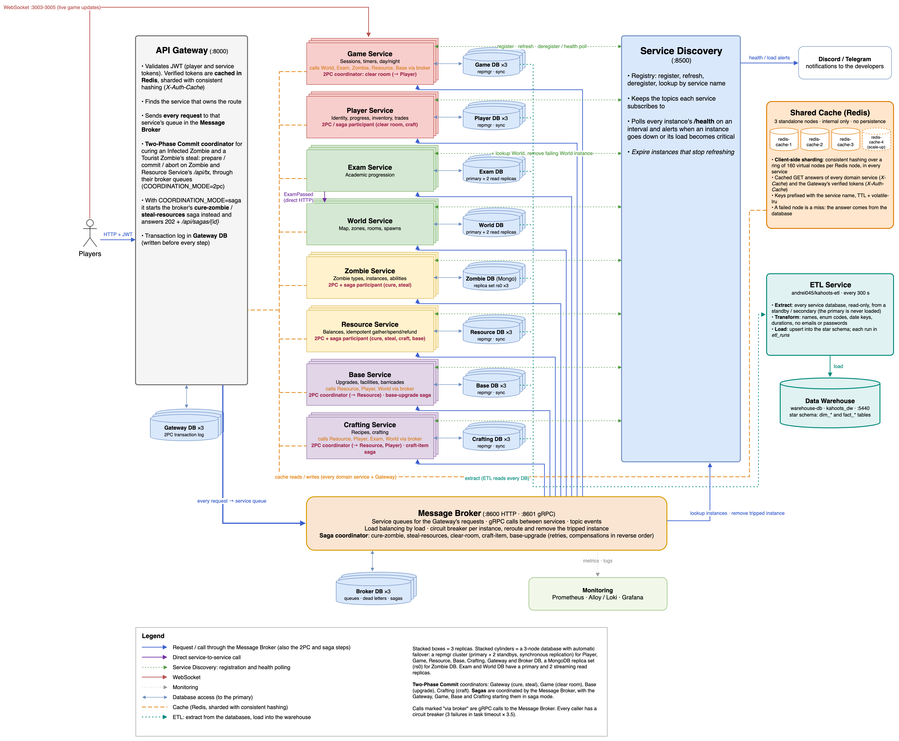

# In Kahoots with the Undead - Communication Contract

This document outlines the communication contracts for the microservices within the **In Kahoots with the Undead** platform — a zombie-survival game set on the FAF campus.

---
## Overview

The platform simulates a campus survival scenario where players gather resources, build up their base, fight off zombies, and pass exams to progress. Each microservice encapsulates a specific domain — player identity, academics, zombies, resources, base management, and crafting. The microservices were designed to ensure modularity, independence, and maintainability.

Microservices are implemented using two technologies:

* **Node.js/TypeScript:** Exam Service, World Service, Zombie Service, Resource Service
* **C#/.NET (ASP.NET Core):** Player Service, Game Service, Base Service, Crafting Service

The infrastructure services are written in **Python (FastAPI)**: the API Gateway (entry point), the Message Broker (service queues, gRPC relay and topic events) and Service Discovery (registry and health polling).

---
## Team Definition

| Team Member | Services Owned |
|---|---|
| Ceaetchii Andrei | Player Service, Game Service |
| Botnari Maria-Elena | Exam Service, World Service |
| Costin Loredana | Zombie Service, Resource Service |
| Bulat Cristian | Base Service, Crafting Service |
| Whole team | API Gateway, Service Discovery, Message Broker |

---
## Data Management Strategy

Every service owns a **database** — no service reads or writes another service's tables directly. All cross-service data access happens through the network, using two patterns:

- **Synchronous requests** for data an actor needs immediately to proceed (e.g. Game Service needs zombie stats before it can spawn an encounter). They go through the Message Broker: `Broker.Relay` over gRPC from a service, a subscriber-based queue over HTTP from the Gateway.
- **Asynchronous events** (the Message Broker's topic-based queues, `Broker.Publish`) for state changes that other services should eventually react to, but that shouldn't stop the initial request (e.g. World Service unlocking a wing doesn't need to block exam grading).

Two rules apply across every state-changing endpoint that moves resources, items, or currency-like values:

- **Idempotency keys.** Any endpoint that deducts something (`POST /api/gather`, `POST /api/spend`, `POST /api/refund`, `POST /api/craft`, trade endpoints) requires an `idempotencyKey`. The receiving service persists a transaction record keyed on it; a repeated call with the same key returns the original result instead of re-applying the effect. This is what makes reconnects and duplicate completion events safe.
- **Sagas for multi-service writes.** Some actions span two databases with no shared transaction (e.g. crafting deducts resources in Resource Service's database *and* adds an item in Player Service's database). These are implemented as a saga: if the second step fails after the first succeeded, the initiating service (Crafting Service, Base Service) issues a compensating call to undo the first step, rather than leaving the two databases inconsistent. From the 5.0.0 images, curing an Infected Zombie and a Tourist Zombie's steal can also run as **long-running sagas coordinated by the Message Broker**, which keeps every saga in a durable store and compensates the done steps in reverse order (see [Sagas](#sagas)).

- **Two-Phase Commits for actions that must change two databases together** (from the 5.0.0 images). Curing an Infected Zombie and a Tourist Zombie's steal change Zombie Service's MongoDB and Resource Service's PostgreSQL at once. The Gateway coordinates them as a Two-Phase Commit: both services first reserve their part and vote, and only then are both told to commit (or both to abort), so the two databases never disagree. See [Two-Phase Commit](#two-phase-commit).

No service is ever a passive shared datastore for another — every read of another domain's data goes through that domain's own API, never a shared schema or cross-service SQL join.

The full communication contract — every endpoint, its payload, and its response — is documented per service below in each service's "Exposed/Consumed API Endpoints" and "Message Queue Events" sections.

## Two-Phase Commit

*From the 5.0.0 images of the Gateway, Zombie Service and Resource Service.*

Two player actions change two services' databases at once:

| Action | Zombie Service (MongoDB) | Resource Service (PostgreSQL) |
|---|---|---|
| Cure an Infected Zombie | the zombie is marked cured | the zombie type's `cureRequirement` is spent |
| A Tourist Zombie steals | the loot is recorded on the zombie | the loot is taken from the player |

The **Gateway is the coordinator** and the two services are the **participants**:

```
player ── POST /api/zombies/z_1/cure ──▶ Gateway (coordinator)
  phase 1   prepare ──▶ Zombie Service     checks the zombie, locks it, votes commit (+ cureRequirement)
            prepare ──▶ Resource Service   holds the cost on the balance, votes commit
  decision  commit, written to the Gateway's transaction log
  phase 2   commit ──▶ Zombie Service      zombie cured, unlocked
            commit ──▶ Resource Service    cost spent
```

1. **Prepare.** Each participant checks it can do its part, reserves it and votes `commit`, or votes `abort` with a reason. Zombie Service locks the zombie (its special action and other transactions are refused while it is locked). Resource Service holds the cost: the resources stay on the balance but nothing else can spend them. A participant that doesn't answer in time counts as an `abort` vote.
2. **Decide.** `commit` only if both voted `commit`. The decision is written to the Gateway's transaction log (SQLite, on a volume) before either participant hears it.
3. **Commit or abort.** The decision is sent to both participants and retried until they acknowledge it. Every participant step is idempotent on the `txId`, so a repeated message is harmless.

**Failures.**

- If the Gateway crashes before deciding, its recovery task aborts the transaction when it restarts: no decision was written, so nothing can have been committed.
- If it crashes after deciding, the recovery sends the decision again.
- A participant releases a reservation that gets no decision within 60 s (`TX_HOLD_TIMEOUT_SECONDS`), so a lost coordinator can't lock a zombie or a balance forever.
- Zombie Service's MongoDB has no multi-document transactions, so it makes every step an atomic conditional update of one document. See the zombie-service README.

The participants' endpoints (`/api/tx/{txId}/...`) are not reachable through the Gateway; only the coordinator calls them, through the Message Broker's service queues.

### Endpoints answered by the Gateway

**`POST /api/zombies/{instanceId}/cure`** *(Consumed by players)*

No body; the player is the one in the token.

**`POST /api/zombies/{instanceId}/steal`** *(Consumed by players)*

The loot is taken from the player in the token. `loot` is 1 to 20 entries with a positive `amount`.

```json
{ "loot": [{ "resourceType": "food", "amount": 3 }] }
```

Response — 200 OK, the transaction committed (`state` is `committing` while a participant has yet to acknowledge; the outcome is already final):
```json
{
  "txId": "tx_8965d2e2403a4fce94ae5b400672e0ef",
  "action": "cure",
  "playerId": "p_44",
  "instanceId": "z_169c0e38",
  "loot": [],
  "costs": [{ "resourceType": "chemicals", "amount": 2 }],
  "state": "committed",
  "decision": "commit",
  "reason": null,
  "participants": {
    "zombie-service": { "vote": "commit", "voteReason": null, "ack": "committed" },
    "resource-service": { "vote": "commit", "voteReason": null, "ack": "committed" }
  },
  "createdAt": "2026-11-22T15:08:43.011Z",
  "updatedAt": "2026-11-22T15:08:43.025Z"
}
```

409 Conflict — the transaction was aborted. The body has the same fields, plus `error` and the `reason`:
- a participant's abort reason: `already_cured`, `not_curable`, `not_a_tourist`, `zombie_busy`, `zombie_not_found` or `insufficient_resources` (with `detail.missing`);
- or `zombie_unavailable` / `resource_unavailable` when a participant couldn't be reached.
```json
{ "error": "transaction_aborted", "message": "The transaction was aborted: insufficient_resources.", "txId": "tx_...", "state": "aborted", "decision": "abort", "reason": "insufficient_resources", "detail": { "missing": { "chemicals": 1 } }, "participants": { "zombie-service": { "vote": "commit", "voteReason": null, "ack": "aborted" }, "resource-service": { "vote": "abort", "voteReason": "insufficient_resources", "ack": "aborted" } } }
```

400 Bad Request — `invalid_body` (invalid `instanceId` or `loot`). 403 Forbidden — `player_token_required` (a service token).

**`GET /api/tx/{txId}`** *(Consumed by players)*

The transaction, in the shape above, with its current `state` (`preparing`, `committing`, `aborting`, `committed`, `aborted`). 404 Not Found — `tx_not_found`, also for another player's transaction.

### Clearing a room (Game Service and Player Service)

*From the 5.0.0 images of Game Service and Player Service.*

Completing a `clear_room` action changes two databases: the action is completed in Game Service's `game_db`, and the room's loot (`salvage`, one per started minute) is added to the player's inventory in Player Service's `player_db`. Here **Game Service is the coordinator**, and it is also the first participant:

```
player ── POST /api/actions/act_1/complete ──▶ Gateway ──▶ Game Service (coordinator, log in game_db)
  log       room_clear_transactions: Preparing
  phase 1   lock the action (in_progress → completing, one conditional UPDATE)       votes commit
            prepare ──▶ Player Service (Broker.Relay)   checks the player, records the grant, votes commit
  decision  commit: written to the log together with the action's outcome (completed), in one DB transaction
  phase 2   commit ──▶ Player Service   salvage added to the inventory, acknowledged
```

- **Prepare.** Game Service locks the action, so a cancel or another completion is refused while it runs. Player Service records the grant and votes `commit`, or `abort` (`player_not_found`). A prepare that isn't answered in 5 s counts as `abort` (`player_unavailable`).
- **Decide.** `commit` only if both voted `commit`. The decision is written to the log (`room_clear_transactions`, Committing / Aborting) in the same database transaction as the action's outcome: completed, or back to in progress.
- **Commit or abort.** The decision is sent to Player Service. Until it acknowledges, the log stays Committing / Aborting and a recovery task on every replica (every 10 s) resends it. Every Player Service step is idempotent on the `txId`.
- **Failures.**
  - A transaction left `Preparing` for 30 s (the replica died before deciding) is aborted by the recovery: no decision was written, so nothing can have committed.
  - Tested by stopping Player Service: the prepare failed, the transaction aborted (`player_unavailable`) and the abort waited as `aborting`; 36 s after Player Service was back, the recovery delivered it (`aborted`, acknowledged).
- Player Service reserves nothing for a prepared grant (adding an item can't conflict with anything), so a transaction waiting for its decision never blocks another one.

The participant endpoints (`/api/players/{id}/tx/{txId}/...`) are not reachable through the Gateway. The outcome is read with `GET /api/actions/{actionId}/transaction` (see [Game Service](#2-game-service)).

---
## Sagas

*From the 5.0.0 images of the Message Broker, the Gateway, Zombie Service and Resource Service.*

The two actions of the [Two-Phase Commit](#two-phase-commit) can instead run as **long-running sagas, coordinated by the Message Broker**. The Gateway's `COORDINATION_MODE` picks one: `2pc` (the default) or `saga`. The endpoints players call are the same either way.

| Saga | Step 1 (action ↔ compensation) | Step 2 (action ↔ compensation) |
|---|---|---|
| `cure-zombie` | Zombie Service: `cure` ↔ `uncure` (returns the cure requirement) | Resource Service: `POST /api/spend` of the cure requirement ↔ `POST /api/refund` with `compensates` |
| `steal-resources` | Resource Service: `POST /api/spend` of the loot ↔ `POST /api/refund` with `compensates` | Zombie Service: `record-loot` ↔ `return-loot` |

```
player ── POST /api/zombies/z_1/cure ──▶ Gateway ── POST /sagas ──▶ Message Broker (saga coordinator)
◀── 202 { sagaId }                                                   │ saved in the saga store (SQLite, volume)
                                                                     ├─ cure ──▶ Zombie Service      ok (+ cureRequirement)
                                                                     ├─ pay  ──▶ Resource Service    402 refused
                                                                     └─ uncure ─▶ Zombie Service     compensated
player ── GET /api/sagas/{sagaId} ──▶ Gateway ──▶ broker     { "state": "compensated", ... }
```

- **Steps.** The broker runs the steps one after the other, through its service queues' delivery (Service Discovery, load balancing, circuit breakers). Each step commits at once in its own service: nothing is locked, unlike the Two-Phase Commit.
- **Failures.**
  - A step the service refuses (`4xx`) is not applied.
  - A step that can't be reached or answers `5xx` is retried with backoff. If it still fails, it may or may not have been applied, so it is compensated too.
  - On a failure, the steps already done are **compensated in reverse order**, each retried until it succeeds. A compensation that keeps failing ends the saga `failed`, and an operator resumes it with `POST /sagas/{sagaId}/retry` on the broker.
- **Durability.** Every transition is saved before the broker acts on it. After a restart, the broker resumes every unfinished saga from its last recorded step; this was tested by killing the broker in the middle of a step.
- **Idempotency.** The step id (`{sagaId}:{step}`) is the idempotency key of every step and compensation, so sending one again applies it once.
- **Compensations are always safe.** A compensation undoes only what its own step did, and succeeds even when there is nothing to undo. It also cancels its step, so a step that was lost and arrives after its compensation is refused (`409 spend_cancelled` / `step_cancelled`) instead of applying something nobody undoes.

### Clearing a room as a saga

*From the 5.0.0 images of the Message Broker, Game Service and Player Service.*

With Game Service's `Coordination__Mode=saga`, [clearing a room](#clearing-a-room-game-service-and-player-service) runs as the broker's `clear-room` saga instead of the Two-Phase Commit. Game Service starts it (`POST /sagas` on the broker, with its service token) and answers `202` with the saga.

| Saga | Step 1 (action ↔ compensation) | Step 2 (action ↔ compensation) |
|---|---|---|
| `clear-room` | Game Service: `POST /api/actions/{id}/saga/complete` ↔ `reopen` | Player Service: `POST /api/players/{id}/inventory/saga/grant` ↔ `revoke` |

- When the grant is refused (`404 player_not_found`), the broker reopens the action: the saga ends `compensated`, the action is in progress again and the inventory is unchanged.
- When the grant can't be reached, it may have been applied, so the broker revokes it too (the revoke carries the item, so it is recorded even if the grant never arrived) and then reopens the action.

### Two-Phase Commit or saga?

| | Two-Phase Commit (`COORDINATION_MODE=2pc`) | Saga (`COORDINATION_MODE=saga`) |
|---|---|---|
| Coordinator | Gateway, transaction log in SQLite | Message Broker, saga store in SQLite |
| Consistency | Atomic: both databases change together, or neither | Eventual: each step commits at once; compensations undo the done steps after a failure |
| While it runs | The zombie is locked and the cost held: other actions on them wait | Nothing is locked; another action can see a half-done saga |
| A participant is slow or down | The prepare times out and everything aborts; reservations expire after 60 s | The step is retried with backoff, possibly for long; the saga waits in the store |
| Coordinator crash | Undecided transactions are aborted at restart; decided ones are resent | The saga resumes from its last recorded step |
| Answer to the player | `200` / `409` once decided | `202` at once; `GET /api/sagas/{sagaId}` for the outcome |
| Participant API | `prepare` / `commit` / `abort` on `/api/tx/{txId}` | One action and one compensation per step |
| Good for | Short actions that must never be seen half-done | Long-running actions across services that can't hold locks |

### Endpoints answered by the Gateway

In `saga` mode, `POST /api/zombies/{instanceId}/cure` and `POST /api/zombies/{instanceId}/steal` take the same input as in the Two-Phase Commit (validated before the broker is called).

Response — 202 Accepted, with `Location: /api/sagas/{sagaId}`; the saga runs in the broker:
```json
{
  "sagaId": "saga_8469fbab58dd44e0961ed397d413edf8",
  "saga": "cure-zombie",
  "state": "running",
  "input": { "playerId": "p_44", "instanceId": "z_0bcad5d9" },
  "failure": null,
  "steps": [
    { "step": "cure", "service": "zombie-service", "state": "pending", "attempts": 0 },
    { "step": "pay", "service": "resource-service", "state": "pending", "attempts": 0 }
  ],
  "createdAt": "2026-11-22T17:20:01.112Z",
  "updatedAt": "2026-11-22T17:20:01.112Z",
  "statusUrl": "/api/sagas/saga_8469fbab58dd44e0961ed397d413edf8"
}
```

Error responses:

- 502 `broker_unreachable` / 504 `downstream_timeout` when the broker can't be reached.
- The broker's own errors as it gives them.
- 503 `saga_coordinator_unavailable` without `BROKER_URL`.

**`GET /api/sagas/{sagaId}`** *(Consumed by players)*

The saga in the shape above, with its current state and, when a step failed, the failure (e.g. `{ "step": "pay", "status": 402, "error": "rejected_insufficient", "missing": { "chemicals": 1 } }`).

- Saga `state`: `running`, `compensating`, `completed`, `compensated` or `failed`.
- Step `state`: `pending`, `running`, `succeeded`, `failed`, `unknown`, `skipped`, `compensating`, `compensated` or `compensation_failed`.
- 404 Not Found — `saga_not_found`, also for another player's saga.

---

# Technologies & Communication Patterns
---

| Team | Services | Language & Framework | Database | Communication Patterns | Motivation & Trade-offs |
|---|---|---|---|---|---|
| Ceaetchii Andrei | Player Service, Game Service | C# / ASP.NET Core | PostgreSQL (both services) | REST/HTTP for clients, gRPC to the Message Broker for calls to other services, WebSockets, broker topic events | C# provides strong typing and asynchronous programming. PostgreSQL ensures data integrity and transactions for player identity, inventory and trades. Game Service uses it as well so both services share one architecture: the same generic repository, migration runner and base entity. Its state is short-lived but still relational (sessions, rosters, timed actions), and one DBMS keeps deployment and the shared compose file simpler. REST is used for request/response communication with clients, gRPC through the Message Broker (`Broker.Relay`, a binary protobuf call over one multiplexed HTTP/2 connection) for Game Service's calls to the other services, WebSockets for real-time updates, and the broker's topic queues for asynchronous cross-service events. Trade-off: Redis would fit ephemeral session state better and was the original choice, but running a single database across both services is simpler to operate at this scale. |
| Botnari Maria-Elena | Exam Service, World Service | Node.js/TypeScript (Express) | PostgreSQL | REST + RabbitMQ events | Both services store structured, relational data (exams and attempts for one, rooms and connections for the other), so one language and one database keeps things simple and easy to maintain across both. Trade-off: without EF Core's built-in migration tooling, schema changes to the room graph require more manual discipline to keep consistent. |
| Costin Loredana | Gateway Service, Zombie Service, Resource Service | Gateway: Python (FastAPI); Others: Node.js/TypeScript (Express) | Gateway: None; Zombie: MongoDB; Resource: PostgreSQL | Gateway: REST routing; Zombie: REST; Resource: REST, idempotency-key-gated | Gateway uses FastAPI to provide an async entry point and routing layer. Node's non-blocking I/O fits the other two I/O-bound services. MongoDB's flexible schema enables rapid Zombie Service iteration without migrations as ability types expand. The correctness-critical Resource Service uses TypeScript and DB transactions to enforce atomic, idempotent balance updates. Trade-off: Node is weaker at CPU-heavy work, but neither service does any, so this cost doesn't apply here. |
| Bulat Cristian | Base Service, Crafting Service | C#/.NET (ASP.NET Core) | PostgreSQL | REST for Base and Crafting Services, gRPC to the Message Broker for calls to other services, broker topic events published and consumed by both | Both services perform "spend and apply" operations that must not partially succeed. C#'s explicit exception handling and EF Core transactions make atomic, saga-style operations across service calls easier to reason about than a dynamically-typed alternative. Trade-off: more boilerplate than Node for simple CRUD, accepted for the correctness guarantee. |

---
# Architectural Diagram of Microservices Operation



The diagram illustrates the microservices architecture for the **In Kahoots with the Undead** system as it runs in the team compose.

- **Entry point.** Players reach the system only through the API Gateway (`:8000`, HTTP + JWT), plus a WebSocket opened straight to a Game Service replica (`:3003-3005`) for live game updates. The Gateway validates the token, finds the service that owns the path and puts the request on that service's **subscriber-based queue** in the Message Broker (HTTP `:8600`).
- **Message Broker.** It hands each request to one registered instance, balancing by service load (instances in critical load last, fewest requests in flight first). It keeps a circuit breaker per instance: when a breaker trips, the request is rerouted to the next instance and the tripped instance is removed from Service Discovery. Load balancing and circuit breaking are no longer the Gateway's job.
- **Service-to-service calls.** Game Service (World, Exam, Zombie, Resource, Base), Base Service (Resource, Player, World) and Crafting Service (Resource, Player, Exam, World) call the other services through the broker over gRPC (`Broker.Relay`). Base and Crafting coordinate their spend-and-apply sagas this way. Resource Service and Zombie Service never call outward. The one direct call left is Exam Service → World Service (`ExamPassed`, HTTP to an instance found in Service Discovery).
- **Events.** Services publish with `Broker.Publish`. The broker delivers a copy to every service subscribed to the topic in Service Discovery as `POST /events/{topic}`. Base Service (`BaseDefenseChanged`) and Crafting Service (`RecipeUnlocked`) already publish. Player, Game, Base and Crafting Service are subscribed to `ExamPassed`, `CourseCompleted`, `AchievementUnlocked`, `ExamFailed` and `ZoneUnlocked`, but Exam and World Service (3.0.0) don't publish on the broker yet.
- **Two-Phase Commit** (from 5.0.0). The Gateway also coordinates the Two-Phase Commits that cure an Infected Zombie or let a Tourist Zombie steal, calling Zombie and Resource Service's `/api/tx/...` endpoints through their broker queues, with its transaction log on a volume (see [Two-Phase Commit](#two-phase-commit)).
- **Sagas** (from 5.0.0). With the Gateway's `COORDINATION_MODE=saga`, the Message Broker coordinates the cure and steal sagas instead: it runs each step on Zombie and Resource Service and compensates the done steps when one fails, with its saga store on its data volume (see [Sagas](#sagas)).
- **Service Discovery** (`:8500`) holds every replica's registration and topics. It polls each instance's `/health` to set its load status and sends alerts to Discord / Telegram.
- **Replicas.** Every domain service runs 3 replicas that share that service's own database.
- **Monitoring.** Prometheus scrapes the broker and the Player, Game, Base and Crafting replicas, Alloy ships every container's logs to Loki, and Grafana shows both.

## Authorization at the Gateway

Every request to the Gateway (`http://localhost:8000`) needs `Authorization: Bearer <jwt>`, except `GET /health`, `POST /api/auth/register` and `POST /api/auth/login`, which return the token. The Gateway validates the token (HS256, signed by Player Service, issuer `player-service`, audience `kahoots-with-the-undead`, not expired) and never forwards the `Authorization` header; for a player token it forwards `X-Player-Id` and `X-Username` instead. A missing, invalid or expired token is answered by the Gateway with `401` and `{ "error": "missing_token" | "invalid_token" | "token_expired", "message": "..." }`.

Services calling through the Gateway present a service token signed with the same secret (`"kind": "service"`); the Gateway forwards its subject as `X-Service-Name` instead of player headers. The secret is `JWT_SECRET` on the Gateway and `Jwt__Secret` on Player and Game Service; all three must match.

Service-to-service calls do not go through the Gateway any more: Game Service reaches World, Exam, Zombie, Resource and Base Service through the Message Broker over gRPC (`Broker.Relay`, see the message-broker README), with the same service token in the call metadata. The routes only the services call are therefore not available through the Gateway, which answers `404` and `{ "error": "route_not_found", "message": "This route is only for the services and is not available through the gateway." }` whatever token the request carries: `PATCH /api/players/{id}/progression`, `POST /api/players/{id}/inventory/items`, `POST /api/players/{id}/achievements`, `/api/players/events`, `/api/sessions/events`, `POST /exams/start`, `POST /exams/{attemptId}/submit`, `POST /exams/{attemptId}/abandon`, `GET /exams/{examId}/retryEligibility`, `POST /api/zombies/spawn`, `POST /api/zombies/{id}/special-action`, `POST /api/inventory/{playerId}`, `POST /api/gather`, `POST /api/spend`, `POST /api/refund`, `POST /api/base/{id}/barricade` and `POST /api/base/{id}/facilities`. The Two-Phase Commit participant endpoints (`POST /api/tx/{txId}/prepare`, `/commit`, `/abort` on Zombie and Resource Service) are not proxied at all: `/api/tx/...` is answered by the Gateway itself. Nor are Zombie Service's saga steps (`/api/zombies/{id}/saga/...`), which only the Message Broker calls. The Postman collections get a token first and send it on every request.

---
## **1. Player Service**

Handles global player identity, progression, and inventory.

### **Owns**
- Player accounts: registration, authentication, profile data.
- Friends and online presence.
- XP totals, levels, and progression.
- The player's inventory: consumables (Coffee, Energy Drinks, Davidan sandwiches) and cosmetics.
- Player-to-player trades, including verifying ownership and transferring items atomically.

### **DockerHub Image**
- **Repository:** [`andrei045/player-service`](https://hub.docker.com/r/andrei045/player-service)
- **Image Tag:** `andrei045/player-service:5.0.0`
- **Default Port:** `Internal only (8080), accessible via Gateway (8000)`

### **Consumed API Endpoints**

- `POST /registry/register`, `DELETE /registry/instances/{instanceId}` *(Service Discovery)* — registers each instance on startup (in the background, retried every 5 s while Service Discovery is unreachable), refreshes the registration every 30 s, and deregisters on shutdown. Run several replicas without `container_name` so each one registers its own container hostname.

Every call to Service Discovery goes through a circuit breaker: 3 failures (`5xx`, timeout, unreachable; a `4xx` is not a failure) within Task Timeout × 3.5 (28 s) trip it, the trip is logged, and registration attempts fail at once until a trial call after the window succeeds. Every request is logged as one JSON line with its status and duration, and every line of a request carries its `X-Request-ID` as `CorrelationId`.


### **Exposed API Endpoints**

**`GET /status`** *(Consumed by development team)*

Describes the running instance: version, when it started and how long it has been up. It needs no token and is exempt from the task limits, like `GET /health`.

Response
```json
{ "status": "ok", "service": "player-service", "version": "5.0.0", "startedAt": "2026-10-26T12:00:00Z", "uptimeSeconds": 42.317, "timestamp": "2026-10-26T12:00:42Z" }
```

**`POST /api/auth/register`** *(Consumed by Gateway)*

Creates a new player account.

Payload
```json
{ "username": "faf_survivor", "password": "hunter2", "email": "student@faf.md" }
```

Response
```json
{ "player_id": "p_44", "jwt": "<jwt_token>" }
```

**`POST /api/auth/login`** *(Consumed by Gateway)*

Authenticates a player and returns a JWT.

Payload
```json
{ "username": "faf_survivor", "password": "hunter2" }
```

Response
```json
{ "jwt": "<jwt_token>", "player_id": "p_44" }
```

**`GET /api/players/{player_id}`** *(Consumed by Gateway, Game Service, Crafting Service)*

Retrieves a player's public profile.

Headers: `Authorization: Bearer <jwt>`

Response
```json
{ "player_id": "p_44", "nickname": "faf_survivor", "level": 7, "xp": 1450, "group": "FAF-211" }
```

**`PATCH /api/players/{player_id}/progression`** *(Consumed by Game Service)*

Updates XP after a gameplay event.

Payload
```json
{ "xpDelta": 50, "reason": "cycle_survived" }
```

Response
```json
{ "player_id": "p_44", "xp": 1500, "level": 7, "leveledUp": false }
```

**`GET /api/players/{player_id}/inventory`** *(Consumed by Gateway)*

Retrieves the player's consumables and cosmetics.

Response
```json
{ "items": [ { "itemId": "coffee", "quantity": 3 }, { "itemId": "cosmetic_cap", "quantity": 1 } ] }
```

**`POST /api/players/{player_id}/inventory/items`** *(Consumed by Crafting Service, Base Service)*

Delivers a crafted item or Kiki reward to the player's inventory.

Payload
```json
{ "itemId": "barricade_kit", "quantity": 1, "source": "craft:recipe_wood_metal" }
```

Response
```json
{ "status": "added", "inventorySnapshot": { "barricade_kit": 1 } }
```

**`POST /api/players/{player_id}/tx/{txId}/prepare`**, **`/commit`**, **`/abort`** *(Consumed by Game Service, through the Message Broker; not available through the Gateway)*

Player Service's side of the room-clearing [Two-Phase Commit](#clearing-a-room-game-service-and-player-service). Prepare checks the player exists, records the grant and votes; the item reaches the inventory only on commit. Every step is idempotent on the `txId`.

Prepare payload
```json
{ "itemId": "salvage", "quantity": 2 }
```

Prepare response (200 OK) — `vote` is `commit`, or `abort` with a `reason` (`player_not_found`)
```json
{ "txId": "tx_6562c7fceda246809cb7bfd674f92efe", "vote": "commit", "reason": null }
```

Commit / abort response (200 OK, no body needed)
```json
{ "txId": "tx_6562c7fceda246809cb7bfd674f92efe", "state": "committed" }
```

404 `tx_not_found` — a commit for a transaction never prepared here. 409 `tx_already_aborted` / `tx_already_committed` — a decision contradicting the one already applied.

**`POST /api/players/{player_id}/inventory/saga/grant`**, **`/revoke`** *(Consumed by Message Broker; not available through the Gateway)*

The step and the compensation of the [`clear-room` saga](#clearing-a-room-as-a-saga). `stepId` is the idempotency key. A grant applies at once; a revoke takes back what its own grant gave (what the player still holds of it) and always succeeds. A revoke that arrives before its grant is recorded, and the late grant is then refused with 409 `step_cancelled`.

Payload (the same for both)
```json
{ "stepId": "saga_3c55b3bb8dfe41658a4941fe762f3c0c:grant", "itemId": "salvage", "quantity": 2 }
```

Response (200 OK) — `state` is `committed`, `revoked` or `cancelled`
```json
{ "stepId": "saga_3c55b3bb8dfe41658a4941fe762f3c0c:grant", "state": "committed" }
```

**`POST /api/players/{player_id}/achievements`** *(Internal handler, triggered by the `AchievementUnlocked` event)*

Grants an achievement directly (also usable by development team for testing).

Payload
```json
{ "achievementId": "achievementSurvivedMathematics", "grantedBy": "exam:mathematics_complete" }
```

Response
```json
{ "status": "granted" }
```

**`POST /api/trades`** *(Consumed by Gateway)*

Initiates an atomic trade between two players. Verifies both parties own the offered items before committing.

Payload
```json
{
  "idempotencyKey": "trade_772",
  "fromPlayerId": "p_44",
  "toPlayerId": "p_77",
  "offer": [ { "itemId": "coffee", "qty": 2 } ],
  "request": [ { "itemId": "sandwich", "qty": 1 } ]
}
```

Success Response (200 OK)
```json
{ "status": "completed", "tradeId": "trade_772" }
```

Error Response (409 Conflict)
```json
{ "status": "rejected", "reason": "insufficient_items" }
```

**`POST /events/{topic}`** *(Consumed by Message Broker)*

Delivery of an event published on a topic Player Service subscribes to (see Message Queue Events below). The broker posts its envelope, with the publisher's event as `payload`, and sends it again later on a `5xx` or a timeout; a `4xx` (unknown or malformed event) tells it not to. The handler ignores an event already applied, so a repeated delivery is harmless.

Payload
```json
{ "messageId": "ddaa98928d344993bc584176e696fbee", "topic": "ExamPassed", "publisher": "exam-service", "publishedAt": "2026-11-03T14:34:14.006033+00:00", "payload": { "playerId": "player_123", "courseCategory": "mathematics", "examId": "discreteMathematicsExam", "attemptId": "attempt_456", "grade": 70, "xpAwarded": 100, "timestamp": "2026-09-08T10:30:00Z" } }
```

Success Response (200 OK)
```json
{ "eventName": "ExamPassedEvent", "status": "applied", "xp": 1350 }
```

**`GET /metrics`** *(Consumed by Prometheus)*

Request counts and durations per route and status in the Prometheus text format (`http_requests_received_total`, `http_request_duration_seconds`, `http_requests_in_progress`), exempt from the task limits like `GET /health`. Not available through the Gateway.

### **Message Queue Events**

Player Service registers with Service Discovery with `"topics": ["ExamPassed", "ExamPassedEvent", "CourseCompleted", "CourseCompletedEvent", "AchievementUnlocked", "AchievementUnlockedEvent"]` (both spellings, until every publisher uses the same one), and the Message Broker delivers the events published on them to `POST /events/{topic}`.

**SUBSCRIBE `ExamPassed`** *(Published by Exam Service)* — awards the XP reported by an exam attempt.

**SUBSCRIBE `CourseCompleted`** *(Published by Exam Service)* — recorded on the player's progress log.

**SUBSCRIBE `AchievementUnlocked`** *(Published by Exam Service)* — awards the achievement and its XP.

---

## **2. Game Service**

The central real-time gameplay service. Manages sessions, the day/night cycle, timers, and timed player actions.

### **Owns**
- Game sessions/lobbies and session timers.
- The day/night cycle state.
- Timed actions in progress: chopping, scavenging, clearing rooms, barricading, upgrading.
- Live WebSocket delivery of action progress and cycle events to clients.

### **DockerHub Image**
- **Repository:** [`andrei045/game-service`](https://hub.docker.com/r/andrei045/game-service)
- **Image Tag:** `andrei045/game-service:5.0.0`
- **Default Port:** `Internal only (8080), accessible via Gateway (8000); WebSocket on 3003-3005`

### **Consumed API Endpoints**

- `POST /registry/register`, `DELETE /registry/instances/{instanceId}` *(Service Discovery)* — registers each instance on startup (in the background, retried every 5 s while Service Discovery is unreachable), refreshes the registration every 30 s, and deregisters on shutdown. Sessions, actions and WebSocket tickets live in the database, so any replica can serve any request.
- `POST /api/zombies/spawn`, `POST /api/zombies/{id}/special-action` *(Zombie Service)* — spawn encounters, trigger professor/tourist actions.
- `GET /world/rooms`, `GET /world/rooms/{id}/spawnPoints` *(World Service)* — determine what's available in the current zone.
- `POST /exams/start`, `POST /exams/{attemptId}/submit`, `POST /exams/{attemptId}/abandon` *(Exam Service)* — run exam encounters.
- `POST /api/gather` *(Resource Service)* — apply a completed gathering action.
- `POST /api/base/{playerId}/barricade`, `POST /api/base/{playerId}/facilities` *(Base Service)* — trigger base actions.
- `PATCH /api/players/{playerId}/progression` *(Player Service)* — award XP after a cycle.
- `POST /api/players/{playerId}/tx/{txId}/prepare | commit | abort` *(Player Service)* — the room-clearing Two-Phase Commit.
- `POST /sagas` *(Message Broker, HTTP `:8600`, set with `Broker__HttpUrl`)* — starts the `clear-room` saga when `Coordination__Mode=saga`.

Game Service calls them through the Message Broker over gRPC (`Broker.Relay` on `message-broker:8601`, set with `Broker__Url`): each call carries the service name, method, path, query, headers and body, and the instance's status, headers and body come back in the answer, so the HTTP clients above the gRPC layer are unchanged. The call is signed with a service token in the metadata (`kind: service`; the broker forwards its subject as `X-Service-Name: game-service`) and the broker picks the instance (load-aware balancing, circuit breakers, rerouting). Each called service, Service Discovery included, has a circuit breaker shared by all its endpoints: 3 failures (`5xx`, timeout, unreachable; a `4xx` is not a failure) within Task Timeout × 3.5 (28 s) trip it, the trip is logged, and calls to that service fail at once (`502`) until a trial call after the window succeeds. Every request and every call to another service is logged as one JSON line with its status and duration, and every line of a request carries its `X-Request-ID` as `CorrelationId`.

### **Exposed API Endpoints**

**`GET /status`** *(Consumed by development team)*

Describes the running instance: version, when it started and how long it has been up. It needs no token and is exempt from the task limits, like `GET /health`.

Response
```json
{ "status": "ok", "service": "game-service", "version": "5.0.0", "startedAt": "2026-10-26T12:00:00Z", "uptimeSeconds": 42.317, "timestamp": "2026-10-26T12:00:42Z" }
```

**`POST /api/sessions/{session_id}/actions`** *(Consumed by Gateway)*

Starts a timed player action.

Payload
```json
{ "playerId": "p_44", "actionType": "scavenge", "targetNodeId": "node_7", "durationSeconds": 300 }
```

Response
```json
{ "actionId": "act_991", "idempotencyKey": "gather_p44_node7_20260908T1200", "status": "in_progress" }
```

**`POST /api/actions/{action_id}/complete`** *(Consumed by Gateway)*

Completes an action and applies its effect: a gather credits Resource Service, a barricade or upgrade goes to Base Service. **Clearing a room** (`clear_room`) grants loot (`salvage`, one per started minute) in Player Service, and must change both databases or neither:

- With `Coordination__Mode=2pc` (the default), Game Service coordinates a [Two-Phase Commit](#clearing-a-room-game-service-and-player-service) and answers once it is decided.

  Response (200 OK) — `state` is `committing` while Player Service has yet to acknowledge; the outcome is already final
  ```json
  {
    "actionId": "act_1cb4b66d", "playerId": "p_5db3a368", "actionType": "clear_room", "status": "completed", "percent": 100,
    "result": {
      "kind": "loot",
      "loot": {
        "itemId": "salvage", "quantity": 2,
        "transaction": {
          "txId": "tx_6562c7fceda246809cb7bfd674f92efe", "actionId": "act_1cb4b66d", "playerId": "p_5db3a368",
          "itemId": "salvage", "quantity": 2, "state": "committed", "decision": "commit", "reason": null,
          "participants": { "game-service": { "vote": "commit", "ack": "committed" }, "player-service": { "vote": "commit", "ack": "committed" } },
          "createdAt": "2026-11-23T06:54:46.359Z", "updatedAt": "2026-11-23T06:54:46.983Z"
        }
      },
      "saga": null
    }
  }
  ```
  409 Conflict — the transaction aborted; the action is back `in_progress` and nothing was granted. `cause` is Player Service's reason (`player_not_found`), `player_unavailable`, or `action_not_in_progress` (another completion got there first).
  ```json
  { "status": "rejected", "reason": "transaction_aborted", "txId": "tx_3cc84fe022b14431ab31661e2a6a718c", "cause": "player_not_found" }
  ```
- With `Coordination__Mode=saga`, the Message Broker runs the [`clear-room` saga](#clearing-a-room-as-a-saga). The answer is **202 Accepted** at once, with `Location: /api/sagas/{sagaId}`, which the Gateway's `GET /api/sagas/{sagaId}` follows.
  ```json
  { "actionId": "act_8ac0e1ca", "status": "in_progress", "result": { "kind": "saga", "loot": null,
    "saga": { "sagaId": "saga_3c55b3bb8dfe41658a4941fe762f3c0c", "saga": "clear-room", "state": "running", "statusUrl": "/api/sagas/saga_3c55b3bb8dfe41658a4941fe762f3c0c" } } }
  ```

409 `action_not_in_progress` — already completed, cancelled, or being completed.

**`GET /api/actions/{action_id}/transaction`** *(Consumed by Gateway)*

The last Two-Phase Commit of a `clear_room` action, in the `transaction` shape above, with its current `state` (`preparing`, `committing`, `aborting`, `committed`, `aborted`). 404 `tx_not_found` when the action has none.

**`POST /api/actions/{action_id}/saga/complete`**, **`/reopen`** *(Consumed by Message Broker; not available through the Gateway)*

The step and the compensation of the `clear-room` saga on Game Service. `complete` moves the action from `in_progress` to `completed` (409 `action_not_in_progress` otherwise); `reopen` puts it back in progress. Both are idempotent on `stepId`, and a `complete` that arrives after its `reopen` is refused with 409 `step_cancelled`.

Payload
```json
{ "stepId": "saga_3c55b3bb8dfe41658a4941fe762f3c0c:complete" }
```

**WebSocket Connection**

Negotiate through the Gateway, then connect directly to Game Service's socket port.

**`POST /api/sessions/{session_id}/websocket`** *(Consumed by Gateway)*

Response
```json
{ "url": "ws://localhost:3003/ws/sessions/session_8bc13aea?ticket=3f9c0e1b7a2d4c6e8f0a1b2c3d4e5f60", "expiresAt": "2026-10-06T08:00:00Z" }
```

The ticket is single-use and valid for one minute. `ws://.../ws/sessions/{session_id}?ticket=...` is served on Game Service's socket port only, so its REST API stays reachable only through the Gateway. A reconnect replays every notification not yet delivered.

**Server → Client Events**
- `action_progress`: `{"type":"action_progress","actionId":"act_991","playerId":"p_44","actionType":"scavenge","percent":40}` (sent when the percentage changes)
- `action_completed`: `{"type":"action_completed","actionId":"act_991","playerId":"p_44","actionType":"scavenge","result":{"kind":"gather","gather":{"status":"applied","newBalance":{"food":12}},"barricade":null,"facility":null}}`
- `cycle_changed`: `{"type":"cycle_changed","cycle":"night","cycleNumber":1,"zone":"mathematicsWing"}`
- `zombie_encounter`: `{"type":"zombie_encounter","zombieInstanceId":"z_991","zombieType":"professor","typeId":"prof_calc","spawnPoint":"mathematicsWing_spawn_1"}`
- `exam_failed`, `zone_unlocked`: the events below, relayed to the session

**`POST /events/{topic}`** *(Consumed by Message Broker)*

Delivery of an event published on a topic Game Service subscribes to (see Message Queue Events below), in the broker's envelope, as for Player Service. A `2xx` means handled, a `4xx` means the broker must not retry it; repeated deliveries are ignored.

Payload
```json
{ "messageId": "ddaa98928d344993bc584176e696fbee", "topic": "ZoneUnlocked", "publisher": "world-service", "publishedAt": "2026-11-03T14:34:14.006033+00:00", "payload": { "zoneId": "mathematicsWing", "roomsAdded": ["physicsLaboratory"], "timestamp": "2026-09-08T10:45:00Z" } }
```

Success Response (200 OK)
```json
{ "eventName": "ZoneUnlockedEvent", "status": "applied", "notificationsCreated": 2 }
```

**`GET /metrics`** *(Consumed by Prometheus)*

Request counts and durations per route and status in the Prometheus text format, on the REST port only, exempt from the task limits like `GET /health`. Not available through the Gateway.

### **Message Queue Events**

Game Service registers with Service Discovery with `"topics": ["ExamFailed", "ExamFailedEvent", "ZoneUnlocked", "ZoneUnlockedEvent"]`, and the Message Broker delivers the events published on them to `POST /events/{topic}`.

**SUBSCRIBE `ExamFailed`** *(Published by Exam Service)* — notifies the client of a failed exam attempt.

**SUBSCRIBE `ZoneUnlocked`** *(Published by World Service)* — relayed to clients over WebSocket.

---

## **3. Exam Service**

Owns the definitions of all courses, questions, and the logic to grade them.

### **Owns**
- Exam definitions (questions, options, correct answers, threshold).
- Exam attempts (in progress, abandoned, passed, failed).
- Achievements and unlock conditions.
- Progress (which exams are passed).

### **DockerHub Image**
- **Repository:** [`mariaelenabotnari/exam-service`](https://hub.docker.com/r/mariaelenabotnari/exam-service)
- **Image Tag:** `mariaelenabotnari/exam-service:5.0.0` (also tagged `mariaelenabotnari/exam-service:latest`)
- **Default Port:** `Internal only (3000), accessible via Gateway (8000)`

### **Consumed API Endpoints**

- `POST /registry/register`, `DELETE /registry/instances/{instanceId}` *(Service Discovery)* — registers this instance on startup, refreshes the registration periodically, and deregisters on shutdown.
- `GET /registry/services/world-service` *(Service Discovery)* — finds the World Service instances for every `ExamPassed` notification. The list is never cached, and one instance is picked per call in round robin order.
- `POST /events/exam-passed` *(World Service)* — tells World Service that a player passed an exam, so it can unlock the next section of the university. It is sent once per passed attempt, with no retry.
- `DELETE /registry/instances/{instanceId}` *(Service Discovery)* — removes a World Service instance after it failed 3 times inside the window (`OUTGOING_CALL_TIMEOUT_SECONDS` × `CIRCUIT_BREAKER_WINDOW_MULTIPLIER`, `3 × 3.5 = 10.5` seconds by default). A failure is a connection error, a timeout, or a response with status `500` or higher; a `4xx` is not a failure. An instance that is removed but still running registers again at its next refresh, with a new `instanceId`.

### **Exposed API Endpoints**

**`POST /exams`** *(Consumed by development team)*

Creates a new exam definition.

Payload
```json
{ "courseCategory": "mathematics", "courseName": "Discrete Mathematics", "passingThreshold": 60, "questions": [ { "id": "q1", "text": "Which of the following is a valid proposition?", "options": ["2 plus 2", "It is raining today", "Close the door", "Blue"], "correctOptionId": 1 } ] }
```

Response
```json
{ "examId": "discreteMathematicsExam", "courseCategory": "mathematics", "courseName": "Discrete Mathematics", "passingThreshold": 60, "questions": [ { "id": "q1", "text": "Which of the following is a valid proposition?", "options": ["2 plus 2", "It is raining today", "Close the door", "Blue"] } ] }
```

**`GET /exams?courseCategory={courseCategory}`** *(Consumed by development team, Gateway)*

Lists the exams, optionally filtered by a course category.

Response
```json
[ { "examId": "discreteMathematicsExam", "courseCategory": "mathematics", "courseName": "Discrete Mathematics", "passingThreshold": 60, "questions": [...] } ]
```

**`GET /exams/{examId}`** *(Consumed by Game Service, Gateway)*

Retrieves an exam's questions and options for a player, without exposing the correct answers.

Response
```json
{ "examId": "discreteMathematicsExam", "courseCategory": "mathematics", "courseName": "Discrete Mathematics", "passingThreshold": 60, "questions": [ { "id": "q1", "text": "Which of the following is a valid proposition?", "options": ["2 plus 2", "It is raining today", "Close the door", "Blue"] } ] }
```

**`PUT /exams/{examId}`** *(Consumed by development team)*

Updates an existing exam's questions or passing threshold.

Payload
```json
{ "passingThreshold": 60, "questions": [ { "text": "Updated question text", "options": ["Option A", "Option B", "Option C", "Option D"], "correctOptionId": 2 } ] }
```

Response
```json
{ "updated": true }
```

**`DELETE /exams/{examId}`** *(Consumed by development team)*

Removes an exam definition that is no longer needed.

Response
```json
{ "deleted": true }
```

**`POST /exams/start`** *(Consumed by Game Service)*

Begins a new attempt for a player who encountered a Professor Zombie. Rejects the request if the player already has an attempt in progress or is under a retry cooldown for this exam.

Payload
```json
{ "playerId": "player_123", "examId": "discreteMathematicsExam", "zombieEncounterId": "encounter_789" }
```

Response
```json
{ "attemptId": "attempt_456", "questions": [ { "id": "q1", "text": "Which of the following is a valid proposition?", "options": ["2 plus 2", "It is raining today", "Close the door", "Blue"] } ] }
```

**`POST /exams/{attemptId}/submit`** *(Consumed by Game Service)*

Records submitted answers, grades the attempt, determines pass or fail, and evaluates whether an achievement is now satisfied.

Payload
```json
{ "playerId": "player_123", "examId": "discreteMathematicsExam", "answers": { "q1": 1 } }
```

Response
```json
{ "passed": true, "score": 70 }
```

On a pass, the attempt is saved first and then the `ExamPassed` notification is sent to World Service. The status stays `200` whatever happens to that notification. When it could not be delivered (no World Service instance in Service Discovery, a timeout, a connection error, or a `404` or `5xx` from the instance), the response also carries `unlockPending: true`; the field is absent when the notification was delivered or the attempt failed.
```json
{ "passed": true, "score": 70, "unlockPending": true }
```

**`POST /exams/{attemptId}/abandon`** *(Consumed by Game Service)*

Marks an attempt as abandoned, called when a player disconnects or leaves the encounter before submitting.

Payload
```json
{}
```

Response
```json
{ "message": "Exam abandoned successfully" }
```

**`GET /exams/{examId}/retryEligibility?playerId={playerId}`** *(Consumed by Game Service)*

Reports whether the player can retry the specified exam.

Response
```json
{ "canRetry": false, "availableAt": "2026-09-08T10:35:00.000Z" }
```

**`GET /players/{playerId}/progress`** *(Consumed by Gateway, Player Service, Crafting Service)*

Reports the player's status for every exam.

Response
```json
{ "discreteMathematicsExam": "passed", "calculus2Exam": "not_started" }
```

**`GET /players/{playerId}/achievements`** *(Consumed by Gateway, Player Service)*

Reports which achievements a player has unlocked and when.

Response
```json
[ { "achievementId": "achievementSurvivedMathematics", "fullAchievementName": "Achievement, Survived Mathematics", "unlockedAt": "2026-09-08T10:30:00.000Z" } ]
```

**`GET /players/{playerId}/exams`** *(Consumed by Gateway)*

Lists the exams the player has attempted, with the status (`passed`, `in_progress`, `failed` or `abandoned`), the best grade and the number of attempts. A player with no attempts gets `[]`. Requires `X-Player-Id` matching the path.

Response
```json
[ { "examId": 1, "courseName": "Discrete Mathematics", "courseCategory": "mathematics", "status": "passed", "bestGrade": 100, "attempts": 2 } ]
```

**`GET /players/{playerId}/courses`** *(Consumed by Gateway)*

Lists the course categories the player has attempted and whether each is complete (all of the category's exams passed). A player with no attempts gets `[]`. Requires `X-Player-Id` matching the path.

Response
```json
[ { "courseCategory": "mathematics", "examsTotal": 6, "examsPassed": 2, "complete": false } ]
```

Both endpoints answer errors in the `{ "error", "details", "requestId" }` shape: `400 invalid_player_id`, `401 missing_player_identity`, `403 player_mismatch`.

### **Message Queue Events**

> The `ExamPassed` notification to World Service is now a direct HTTP call (see Consumed API Endpoints), so `ExamPassedEvent` is no longer logged by Exam Service. The other events below are still only written to its log; no message queue is connected yet.

**PUBLISH `ExamPassedEvent`** *(Consumed by Player Service)*
```json
{ "playerId": "player_123", "courseCategory": "mathematics", "examId": "discreteMathematicsExam", "attemptId": "attempt_456", "grade": 70, "xpAwarded": 100, "timestamp": "2026-09-08T10:30:00Z" }
```

**PUBLISH `ExamFailedEvent`** *(Consumed by Game Service)*
```json
{ "playerId": "player_123", "courseCategory": "mathematics", "examId": "discreteMathematicsExam", "attemptId": "attempt_457", "timestamp": "2026-09-08T10:40:00Z" }
```

**PUBLISH `CourseCompletedEvent`** *(Consumed by Player Service)*
```json
{ "playerId": "player_123", "courseCategory": "mathematics", "timestamp": "2026-09-08T10:45:00Z" }
```

**PUBLISH `AchievementUnlockedEvent`** *(Consumed by World Service, Player Service, Crafting Service)*
```json
{ "playerId": "player_123", "achievementId": "achievementSurvivedMathematics", "fullAchievementName": "Achievement, Survived Mathematics", "xpAwarded": 500, "timestamp": "2026-09-08T10:45:00Z" }
```

---

## **4. World Service**

Owns the persistent physical state of the university.

### **Owns**
- Every zone, every room within each zone, the connections between rooms.
- The type of resource each room produces.
- Every zombie spawn point, including which zombie category is allowed at each.
- Which zones are currently unlocked.

### **DockerHub Image**
- **Repository:** [`mariaelenabotnari/world-service`](https://hub.docker.com/r/mariaelenabotnari/world-service)
- **Image Tag:** `mariaelenabotnari/world-service:5.0.0` (also tagged `mariaelenabotnari/world-service:latest`)
- **Default Port:** `Internal only (3001), accessible via Gateway (8000)`

### **Consumed API Endpoints**

- `POST /registry/register`, `DELETE /registry/instances/{instanceId}` *(Service Discovery)* — registers each instance on startup, refreshes the registration periodically, and deregisters on shutdown. Run several World Service replicas without `container_name` or a fixed host port so each one gets its own address.

### **Exposed API Endpoints**

**`GET /health`** *(Consumed by Docker healthcheck, Service Discovery, development team)*

Returns service health, database connectivity, uptime and concurrency counters: `200 OK` when healthy, `503` when the database check fails or times out. It needs no identity header.

Response
```json
{ "status": "ok", "service": "world-service", "version": "1.0.0", "instanceId": "70d47addd4e645a9bbae9f14a5383798", "hostname": "ea93129ca3f1", "registeredWithDiscovery": true, "uptimeSeconds": 123, "timestamp": "2026-10-25T16:00:00.000Z", "database": "up", "concurrency": { "current": 3, "max": 50 } }
```

**`POST /world/zones`** *(Consumed by development team)*

Creates a new zone.

Payload
```json
{ "zoneId": "mathematicsWing", "name": "Mathematics Wing", "unlocked": false }
```

Response
```json
{ "zoneId": "mathematicsWing", "name": "Mathematics Wing", "unlocked": false, "unlockedAt": null }
```

**`GET /world/zones`** *(Consumed by Game Service, Gateway, Crafting Service)*

Returns the full list of zones and their unlocked status.

Response
```json
[ { "zoneId": "zoneZero", "name": "Technical University of Moldova Main Campus", "unlocked": true }, { "zoneId": "mathematicsWing", "name": "Mathematics Wing", "unlocked": false } ]
```

**`GET /world/zones/{zoneId}`** *(Consumed by Game Service, Gateway)*

Returns the details of a single zone, including the rooms it contains.

Response
```json
{ "zoneId": "mathematicsWing", "name": "Mathematics Wing", "unlocked": false, "rooms": ["physicsLaboratory", "mathematicsWingLibrary", "mathematicsWingCanteen"] }
```

**`GET /world/zones/{zoneId}/status`** *(Consumed by Gateway, Game Service)*

Reports whether a specific zone is currently unlocked and when it was unlocked.

Response
```json
{ "unlocked": true, "unlockedAt": "2026-09-08T10:45:00.000Z" }
```

**`PUT /world/zones/{zoneId}`** *(Consumed by development team)*

Updates a zone's properties.

Response
```json
{ "zoneId": "mathematicsWing", "name": "Mathematics Wing Updated", "unlocked": true }
```

**`DELETE /world/zones/{zoneId}`** *(Consumed by development team)*

Deletes a zone.

Response
```json
{ "deleted": true }
```

**`POST /world/rooms`** *(Consumed by development team)*

Creates a new room.

Response
```json
{ "roomId": "mathematicsExamHall", "fullRoomName": "Mathematics Exam Hall", "type": "classroom", "zoneId": "zoneZero", "connectsTo": ["mainCorridor"] }
```

**`GET /world/rooms`** *(Consumed by Game Service)*

Returns the list of rooms, optionally filtered by zone and unlocked status.

Query Parameters: `zoneId`, `unlockedOnly`

Response
```json
[ { "roomId": "mathematicsExamHall", "fullRoomName": "Mathematics Exam Hall", "type": "classroom", "zoneId": "zoneZero", "connectsTo": ["mainCorridor"] } ]
```

**`GET /world/rooms/{roomId}`** *(Consumed by Game Service, Base Service)*

Returns the full detail of a single room.

Response
```json
{ "roomId": "mathematicsExamHall", "fullRoomName": "Mathematics Exam Hall", "type": "classroom", "zoneId": "zoneZero", "connectsTo": ["mainCorridor"] }
```

**`PUT /world/rooms/{roomId}`** *(Consumed by development team)*

Updates a room.

Response
```json
{ "roomId": "mathematicsExamHall", "fullRoomName": "Mathematics Exam Hall Updated", "type": "classroom", "zoneId": "zoneZero", "connectsTo": ["mainCorridor"] }
```

**`DELETE /world/rooms/{roomId}`** *(Consumed by development team)*

Deletes a room.

Response
```json
{ "deleted": true }
```

**`GET /world/rooms/{roomId}/connections`** *(Consumed by Game Service)*

Returns the list of rooms directly reachable from a given room.

Response
```json
["mainCorridor"]
```

**`GET /world/rooms/{roomId}/resourceNode`** *(Consumed by Game Service, Resource Service)*

Returns the resource type a given room produces.

Response
```json
{ "resourceType": "metal scraps" }
```

**`GET /world/rooms/{roomId}/spawnPoints`** *(Consumed by Game Service)*

Returns the spawn points available in a room and the zombie category allowed at each.

Response
```json
[
  {
    "spawnPointId": "mathematicsExamHallSpawnOne",
    "roomId": "mathematicsExamHall",
    "zombieCategoryAllowed": "professor",
    "tiedCourseCategory": "mathematics"
  }
]
```

**`GET /world/spawnPoints`** *(Consumed by development team)*

Lists all defined zombie spawn points across campus.

Response
```json
[
  {
    "spawnPointId": "mathematicsExamHallSpawnOne",
    "roomId": "mathematicsExamHall",
    "zombieCategoryAllowed": "professor",
    "tiedCourseCategory": "mathematics"
  }
]
```

**`POST /world/spawnPoints`** *(Consumed by development team)*

Creates a new zombie spawn point tied to a specific room.

Payload
```json
{
  "roomId": "mathematicsExamHall",
  "zombieCategoryAllowed": "professor",
  "tiedCourseCategory": "mathematics"
}
```

Response
```json
{
  "spawnPointId": "spawn_123",
  "roomId": "mathematicsExamHall",
  "zombieCategoryAllowed": "professor",
  "tiedCourseCategory": "mathematics"
}
```

**`GET /world/spawnPoints/{spawnPointId}`** *(Consumed by development team)*

Retrieves details of a specific spawn point.

Response
```json
{
  "spawnPointId": "mathematicsExamHallSpawnOne",
  "roomId": "mathematicsExamHall",
  "zombieCategoryAllowed": "professor",
  "tiedCourseCategory": "mathematics"
}
```

**`PUT /world/spawnPoints/{spawnPointId}`** *(Consumed by development team)*

Updates spawn point parameters (allowed category or tied course category).

Response
```json
{
  "spawnPointId": "mathematicsExamHallSpawnOne",
  "roomId": "mathematicsExamHall",
  "zombieCategoryAllowed": "professor",
  "tiedCourseCategory": "mathematics"
}
```

**`DELETE /world/spawnPoints/{spawnPointId}`** *(Consumed by development team)*

Removes a spawn point configuration.

Response
```json
{
  "deleted": true
}
```

**`POST /world/zones/unlock`** *(Internal handler, triggered by the `AchievementUnlockedEvent`; also usable by development team for testing)*

Triggers the unlock of the zone that matches an achievement. It requires the `X-Service-Name` header (`403 { "message": "Forbidden" }` without it).

Payload
```json
{ "achievementId": "achievementSurvivedMathematics", "playerId": "player_123" }
```

Response
```json
{ "message": "Unlock triggered" }
```

**`POST /events/exam-passed`** *(Consumed by Exam Service)*

Tells World Service that a player passed an exam, so it can unlock the next section of the university. Exam Service calls this path on the instance's own `baseUrl` found in Service Discovery, inside the Docker network and **not through the Gateway**, so there is no `/world` prefix. Headers: `X-Service-Name: exam-service` and `X-Request-Id`.

**World Service must treat `eventId` as idempotent:** a repeated `eventId` must answer `2xx` without unlocking twice. Any `2xx` counts as delivered. A `5xx`, a timeout or a connection error counts as a failure of that instance, and 3 failures inside the window remove the instance from Service Discovery. A `4xx` (including `404`) is not counted as a failure, but Exam Service reports it as `unlockPending: true`.

Payload
```json
{ "eventId": "3f0c9a52b7d14e6fa1c8d2e45b9a7f10", "playerId": "player_123", "examId": "1", "course": "Discrete Mathematics", "gradedAt": "2026-09-08T10:30:00.000Z" }
```
`eventId` is a UUID v4 in hex (32 characters), `examId` is the exam's id, `course` is its course name, and `gradedAt` is ISO 8601 UTC.

Response *(proposed)*
```json
{ "eventId": "3f0c9a52b7d14e6fa1c8d2e45b9a7f10", "duplicate": false }
```

> **Status: not implemented in World Service yet, and not confirmed by the World team.** Until it exists, World Service answers `404`, which Exam Service logs as a `WARN` and reports as `unlockPending: true` on the exam submit response.

### **Message Queue Events**

**SUBSCRIBE `AchievementUnlockedEvent`** *(Published by Exam Service)*
```json
{ "playerId": "player_123", "achievementId": "achievementSurvivedMathematics", "fullAchievementName": "Achievement, Survived Mathematics", "xpAwarded": 500, "timestamp": "2026-09-08T10:45:00Z" }
```

**PUBLISH `ZoneUnlockedEvent`** *(Consumed by Game Service, Base Service, Crafting Service)*
```json
{ "zoneId": "mathematicsWing", "roomsAdded": ["physicsLaboratory", "mathematicsWingLibrary", "mathematicsWingCanteen"], "timestamp": "2026-09-08T10:45:00Z" }
```

---

## **5. Zombie Service**

Owns the persistent definitions and short-lived instance state of zombies.

### **Owns**
- Zombie type definitions: stats, behavior configuration, special abilities.
- Three categories — Professor Zombies (initiate exams), Tourist Zombies (roam, steal resources/XP) and Infected Zombies (students who can be cured instead of fought, at a resource cost). Other categories may be added later.
- Short-lived zombie instance state during a game cycle (health, spawn point reference, cycle and zone). Instances expire automatically 4 hours after they are spawned.

### **DockerHub Image**
- **Repository:** [`costinloredana/zombie-service`](https://hub.docker.com/r/costinloredana/zombie-service)
- **Image Tag:** `costinloredana/zombie-service:5.0.0`
- **Default Port:** `Internal only (4001), accessible via Gateway (8000)`

### **Consumed API Endpoints**

None. Zombie Service never calls other services. Game Service coordinates what follows from most zombie actions; a cure and a Tourist Zombie's steal, which also change Resource Service's database, are Two-Phase Commits coordinated by the Gateway (see [Two-Phase Commit](#two-phase-commit)).

### **Exposed API Endpoints**

Every error response has the shape `{ "error": "<code>", "message": "<reason>" }`. From 5.0.0, any endpoint that reaches the database answers `503` with `Retry-After: 2` and `{ "error": "database_unavailable", "message": "The database is failing over to a new primary. Retry in a few seconds." }` while no node is the primary (see [Database replication and failover](#database-replication-and-failover-zombie-service-resource-service)).

**`GET /health`** *(Consumed by Docker healthcheck)*

Response
```json
{ "status": "ok", "service": "zombie-service" }
```

**`GET /status`** *(Consumed by development team)*

Describes the running instance. Unlike `GET /health`, it also checks that MongoDB answers (a `ping` command, up to 2 s), and from 5.0.0 it reports the replicated database and the cache.

Response — 200 OK
```json
{
  "status": "ok",
  "service": "zombie-service",
  "version": "5.0.0",
  "startedAt": "2026-11-23T09:12:03.418Z",
  "uptimeSeconds": 42.317,
  "timestamp": "2026-11-23T09:12:45.735Z",
  "dependencies": { "database": "ok" },
  "replication": {
    "mode": "replicaSet",
    "replicaSet": "rs0",
    "primary": "zombie-db-1:27017",
    "members": [
      { "host": "zombie-db-1:27017", "role": "primary" },
      { "host": "zombie-db-2:27017", "role": "secondary" },
      { "host": "zombie-db-3:27017", "role": "secondary" }
    ],
    "primaryChanges": 0
  },
  "cache": {
    "enabled": true,
    "vnodes": 160,
    "ttlSeconds": 300,
    "nodes": [
      { "node": "redis-cache-1:6379", "up": true },
      { "node": "redis-cache-2:6379", "up": true },
      { "node": "redis-cache-3:6379", "up": true }
    ]
  }
}
```

503 Service Unavailable — the same body with `"status": "degraded"` and `"dependencies": { "database": "unreachable" }` when MongoDB does not answer within 2 s.

| Field | Description |
|---|---|
| `version` | The `package.json` version, the same one the DockerHub image is tagged with |
| `dependencies.database` | `ok` or `unreachable` |
| `replication.mode` | `replicaSet`, or `standalone` for a single `mongod` |
| `replication.replicaSet` | The replica set's name (`rs0`) |
| `replication.primary` | The node the service writes to; `null` while a failover is in progress |
| `replication.members` | Each node's `role`: `primary`, `secondary` or `unreachable` |
| `replication.primaryChanges` | The failovers this instance has followed since it started |
| `cache` | `{ "enabled": false }`, or the virtual nodes per Redis node, the TTL and each node's state (`up: false` while it is skipped after a failure). The cache never makes the status `degraded` |

**`GET /metrics`** *(Consumed by Prometheus)*

The state of the instance in the Prometheus text format, scraped every 10 s and shown in Grafana. It needs no token, is exempt from the task limits like `GET /health`, and is not available through the Gateway. The HTTP metrics have the same names and labels as Player, Game, Base and Crafting Service: `http_requests_received_total` and `http_request_duration_seconds` by `code`, `method` and `route` (the route template, or `unmatched`), and `http_requests_in_progress`. Also `kahoots_database_up` (MongoDB answered at scrape time), `kahoots_circuit_breaker_open{target="discovery-service"}` and the Node.js process metrics (`process_*`, `nodejs_*`).

**`GET /api/zombie-types?category=professor|tourist|infected`** *(Consumed by Game Service)*

Returns zombie type definitions, optionally filtered by category. `curable` and `cureRequirement` are only present on curable (infected) types.

Response
```json
[
  { "typeId": "prof_calc", "category": "professor", "name": "Calculus Professor", "baseHealth": 40, "attackStrength": 5, "moveSpeed": 1.0, "perceptionRadius": 6, "specialAbility": "initiate_exam" },
  { "typeId": "infected_student", "category": "infected", "name": "Infected Student", "baseHealth": 22, "attackStrength": 1, "moveSpeed": 1.2, "perceptionRadius": 7, "specialAbility": "seek_cure", "curable": true, "cureRequirement": { "resourceType": "chemicals", "amount": 2 } }
]
```

400 Bad Request — unknown `category` value:
```json
{ "error": "invalid_zombie_type", "message": "category must be 'professor', 'tourist', or 'infected'" }
```

**`GET /api/zombie-types/{typeId}`** *(Consumed by Game Service)*

Returns a single zombie type (same shape as above), or `404 not_found`.

**`POST /api/zombie-types`** *(Consumed by development team, Admin only)*

Defines a new zombie variant. `typeId` is generated as `<category>_<8 hex chars>`. `curable` and `cureRequirement` are optional, but `cureRequirement` is required when `curable` is `true`.

Payload
```json
{ "category": "tourist", "name": "Exchange Student", "baseHealth": 15, "attackStrength": 1, "moveSpeed": 2.0, "perceptionRadius": 8, "specialAbility": "steal_xp" }
```

Response — 201 Created:

```json
{
  "typeId": "tourist_1a2b3c4d",
  "category": "tourist",
  "name": "Exchange Student",
  "baseHealth": 15,
  "attackStrength": 1,
  "moveSpeed": 2.0,
  "perceptionRadius": 8,
  "specialAbility": "steal_xp"
}
```

400 Bad Request — a required field is missing, `category` is invalid, or `curable: true` comes without a valid `cureRequirement`:
```json
{ "error": "invalid_zombie_type", "message": "Missing fields: baseHealth, moveSpeed" }
```
409 Conflict — a zombie type with the same `name` already exists:
```json
{ "error": "zombie_type_exists", "message": "A zombie type with this name already exists." }
```

**`PUT /api/zombie-types/{typeId}`** *(Consumed by development team, Admin only)*

Partially updates a zombie type; only the fields sent are changed, validated with the same rules as create.

Payload
```json
{ "baseHealth": 25 }
```

Returns `200 OK` with the updated type, `400 invalid_zombie_type`, or `404 not_found`.

**`DELETE /api/zombie-types/{typeId}`** *(Consumed by development team, Admin only)*

Returns `204 No Content`, or `404 not_found`.

**`POST /api/zombies/spawn`** *(Consumed by Game Service)*

Instantiates zombies at cycle start. For each instance a category is picked using `typeWeights` (keys `professor`, `tourist` or `infected`; non-negative numbers, at least one above 0), then a random zombie type from that category. Instances start with the type's `baseHealth`.

Payload
```json
{ "cycleId": "cyc_884", "worldZoneId": "zone_12", "spawnCount": 5, "typeWeights": { "professor": 0.3, "tourist": 0.7 } }
```

Response — 201 Created:
```json
{
  "zombies": [
    { "instanceId": "z_a3cecfcc", "typeId": "prof_calc", "category": "professor", "health": 40, "spawnPoint": "zone_12_spawn_1", "cycleId": "cyc_884", "worldZoneId": "zone_12", "createdAt": "2026-09-23T15:15:45.963Z" }
  ]
}
```

400 Bad Request — a field is missing or invalid, or a weighted category has no zombie types yet:
```json
{ "error": "invalid_spawn_request", "message": "spawnCount must be a positive integer." }
```

**`POST /api/zombies/{instance_id}/special-action`** *(Consumed by Game Service)*

Triggers a zombie's special action against a player. The response always carries `actionType` (the type's `specialAbility`) and `targetPlayerId`, plus one category-specific field:

| Category | Extra field | Meaning for Game Service |
|---|---|---|
| `professor` | `suggestedExamCategory` | Start an exam encounter in that course category via Exam Service |
| `tourist` | `suggestedAmount` | Resources/XP to steal from the player via Resource Service |
| `infected` | `cureRequirement` | What the player must spend (via Resource Service) to cure the zombie |

Payload
```json
{ "targetPlayerId": "p_44" }
```

Response — 200 OK (one example per category):
```json
{ "actionType": "initiate_exam", "targetPlayerId": "p_44", "suggestedExamCategory": "Programming" }
```
```json
{ "actionType": "steal_resource", "targetPlayerId": "p_44", "suggestedAmount": { "food": 4 } }
```
```json
{ "actionType": "seek_cure", "targetPlayerId": "p_44", "cureRequirement": { "resourceType": "chemicals", "amount": 2 } }
```

400 Bad Request — `targetPlayerId` missing:
```json
{ "error": "invalid_special_action_request", "message": "targetPlayerId is required." }
```
404 Not Found — the instance was never spawned, has expired, or its zombie type was deleted:
```json
{ "error": "not_found", "message": "Zombie instance not found. It may not have been spawned yet." }
```
409 Conflict — from 5.0.0, the zombie is locked by a Two-Phase Commit in progress (`zombie_busy`), or it was cured (`zombie_cured`):
```json
{ "error": "zombie_busy", "message": "This zombie is held by a transaction in progress; try again shortly." }
```

**`POST /api/tx/{txId}/prepare`** *(Consumed by the Gateway, Two-Phase Commit coordinator — from 5.0.0)*

Checks the zombie can take the action and locks it for the transaction.

- A cure needs an Infected Zombie of a curable type that isn't cured yet.
- A steal needs a Tourist Zombie.

`loot` is required for a steal and not allowed for a cure. A repeated prepare answers the same vote (`status`: `already_prepared`, `already_committed` or `already_aborted`).

Payload
```json
{ "action": "cure", "instanceId": "z_169c0e38", "playerId": "p_44" }
```
```json
{ "action": "steal", "instanceId": "z_4ede2728", "playerId": "p_44", "loot": [{ "resourceType": "food", "amount": 3 }] }
```

Response — 200 OK, vote commit (a cure also returns the type's `cureRequirement`):
```json
{ "txId": "tx_8965d2e2403a4fce94ae5b400672e0ef", "vote": "commit", "state": "prepared", "status": "prepared", "expiresAt": "2026-11-22T15:09:43.011Z", "cureRequirement": { "resourceType": "chemicals", "amount": 2 } }
```
Response — 200 OK, vote abort (`abortReason`: `zombie_not_found`, `not_curable`, `already_cured`, `not_a_tourist` or `zombie_busy`):
```json
{ "txId": "tx_8965d2e2403a4fce94ae5b400672e0ef", "vote": "abort", "state": "aborted", "status": "rejected", "abortReason": "already_cured" }
```
400 Bad Request — `invalid_body`. 409 Conflict — `tx_mismatch`: the `txId` was prepared for another action, zombie, player or loot.

**`POST /api/tx/{txId}/commit`** *(Consumed by the Gateway — from 5.0.0)*

Saves the cure (`curedAt`, `curedBy`) or the loot on the zombie and unlocks it. No body.

Response — 200 OK:
```json
{ "txId": "tx_8965d2e2403a4fce94ae5b400672e0ef", "state": "committed", "status": "committed" }
```
`status` is `already_committed` for a repeated commit. 404 Not Found — `tx_not_found`: never prepared here. 409 Conflict — `tx_aborted`, with the `abortReason` (`coordinator`, `expired`, a vote's reason).

**`POST /api/tx/{txId}/abort`** *(Consumed by the Gateway — from 5.0.0)*

Unlocks the zombie unchanged. No body. An abort for a `txId` never prepared here is remembered (`abortReason: "aborted_before_prepare"`), so a prepare arriving late votes abort.

Response — 200 OK:
```json
{ "txId": "tx_8965d2e2403a4fce94ae5b400672e0ef", "state": "aborted", "status": "aborted", "abortReason": "coordinator" }
```
`status` is `already_aborted` for a repeated abort. 409 Conflict — `tx_committed`.

**`GET /api/tx/{txId}`** *(Consumed by the Gateway, for its recovery — from 5.0.0)*

Response — 200 OK:
```json
{ "txId": "tx_8965d2e2403a4fce94ae5b400672e0ef", "state": "committed", "action": "cure", "instanceId": "z_169c0e38", "playerId": "p_44", "loot": [], "abortReason": null, "expiresAt": null, "createdAt": "2026-11-22T15:08:43.011Z", "updatedAt": "2026-11-22T15:08:43.020Z" }
```
404 Not Found — `tx_not_found`.

**`POST /api/zombies/{instanceId}/saga/cure`** *(Consumed by the Message Broker's saga coordinator — from 5.0.0)*

The `cure` step of `cure-zombie`: cures an Infected Zombie of a curable type for the step.

Payload
```json
{ "stepId": "saga_acec4a7c:cure", "playerId": "p_44" }
```

Response — 200 OK. `cureRequirement` is for the broker's next step; `status` is `already_cured_by_step` for a repeated step:
```json
{ "stepId": "saga_acec4a7c:cure", "instanceId": "z_feb38327", "status": "cured", "cureRequirement": { "resourceType": "chemicals", "amount": 2 } }
```

Errors:

- 409 Conflict — `not_curable`, `already_cured`, `zombie_busy` (held by a Two-Phase Commit) or `step_cancelled` (the step was already compensated).
- 404 — `zombie_not_found`.
- 400 — `invalid_body`.

**`POST /api/zombies/{instanceId}/saga/record-loot`** *(Consumed by the Message Broker's saga coordinator — from 5.0.0)*

The `record-loot` step of `steal-resources`: adds the loot to a Tourist Zombie, as `{ txId: <stepId>, playerId, resources, stolenAt }`.

```json
{ "stepId": "saga_b81d:record-loot", "playerId": "p_44", "loot": [{ "resourceType": "food", "amount": 3 }] }
```

Response — 200 OK, `{ "stepId": "saga_b81d:record-loot", "instanceId": "z_45bac9c3", "status": "recorded" }` (`already_recorded` for a repeated step).

Errors:

- 409 Conflict — `not_a_tourist`, `zombie_busy` or `step_cancelled`.
- 404 — `zombie_not_found`.
- 400 — `invalid_body`.

**`POST /api/zombies/{instanceId}/saga/uncure`** and **`POST /api/zombies/{instanceId}/saga/return-loot`** *(Consumed by the Message Broker's saga coordinator — from 5.0.0)*

The compensations: they revert only what their step id did (the cure, the loot entry), and record the step as compensated in the same atomic update, so the step is refused if it arrives afterwards.

```json
{ "stepId": "saga_acec4a7c:cure" }
```

Response — always 200 OK (also for an expired zombie), with `status` `uncured` / `returned`, or `nothing_to_undo`:
```json
{ "stepId": "saga_acec4a7c:cure", "instanceId": "z_feb38327", "status": "uncured" }
```

---

## **6. Resource Service**

Owns the university's resource economy independently from the physical map.

### **Owns**
- Resource type definitions. The seeded ids are `wood`, `metal`, `paper`, `food`, `chemicals` and `electronics`; new ids are the lowercase name with spaces replaced by `_` (e.g. `"Chemical Waste"` → `chemical_waste`).
- Player resource inventories/balances.
- Resource node state (how much is available at a given gatherable location).
- The full transaction/idempotency ledger for every resource change.
- Two-Phase Commit holds: resources reserved by a prepared transaction (from 5.0.0).

### **DockerHub Image**
- **Repository:** [`costinloredana/resource-service`](https://hub.docker.com/r/costinloredana/resource-service)
- **Image Tag:** `costinloredana/resource-service:5.0.0`
- **Default Port:** `Internal only (4002), accessible via Gateway (8000)`

### **Consumed API Endpoints**

None. Resource Service never calls other services. Node state is stored in its own database; Game Service reads which node a room has from World Service (`GET /world/rooms/{roomId}/resourceNode`) and passes that `nodeId` to `POST /api/gather`.

### **Exposed API Endpoints**

Errors use the shape `{ "error": "<code>", "message": "<reason>" }` (`invalid_body` / `invalid_resource_type` for 400, `not_found` for 404, `resource_type_exists` / `inventory_exists` for 409). The only exception is the 402 from `/api/spend`, shown below. From 5.0.0, any endpoint that reaches the database answers `503` with `Retry-After: 2` and `{ "error": "database_unavailable", "message": "The database is failing over to a new primary. Retry in a few seconds." }` while no node is the primary (see [Database replication and failover](#database-replication-and-failover-zombie-service-resource-service)).

**`GET /health`** *(Consumed by Docker healthcheck)*

Response
```json
{ "status": "ok", "service": "resource-service" }
```

**`GET /status`** *(Consumed by development team)*

Describes the running instance. Unlike `GET /health`, it also checks that PostgreSQL answers (`SELECT 1`, up to 2 s), and from 5.0.0 it reports the replicated database and the cache.

Response — 200 OK
```json
{
  "status": "ok",
  "service": "resource-service",
  "version": "5.0.0",
  "startedAt": "2026-11-23T09:12:03.418Z",
  "uptimeSeconds": 42.317,
  "timestamp": "2026-11-23T09:12:45.735Z",
  "dependencies": { "database": "ok" },
  "replication": {
    "mode": "replicated",
    "primary": "resource-db-1:5432",
    "members": [
      { "host": "resource-db-1:5432", "role": "primary" },
      { "host": "resource-db-2:5432", "role": "standby" },
      { "host": "resource-db-3:5432", "role": "standby" }
    ],
    "primaryChanges": 0,
    "lastCheckedAt": "2026-11-23T09:12:44.102Z"
  },
  "cache": {
    "enabled": true,
    "vnodes": 160,
    "ttlSeconds": 300,
    "nodes": [
      { "node": "redis-cache-1:6379", "up": true },
      { "node": "redis-cache-2:6379", "up": true },
      { "node": "redis-cache-3:6379", "up": true }
    ]
  }
}
```

503 Service Unavailable — the same body with `"status": "degraded"` and `"dependencies": { "database": "unreachable" }` when PostgreSQL does not answer within 2 s.

| Field | Description |
|---|---|
| `version` | The `package.json` version, the same one the DockerHub image is tagged with |
| `dependencies.database` | `ok` or `unreachable` |
| `replication.mode` | `replicated` with `DATABASE_HOSTS`, or `single` for `DATABASE_URL`'s host only |
| `replication.lastCheckedAt` | When the nodes were last checked (every 2 s, and at once after a connection error) |
| `replication.primary` | The node the service writes to; `null` while a failover is in progress |
| `replication.members` | Each node's `role`: `primary`, `standby` or `unreachable` |
| `replication.primaryChanges` | The failovers this instance has followed since it started |
| `cache` | `{ "enabled": false }`, or the virtual nodes per Redis node, the TTL and each node's state (`up: false` while it is skipped after a failure). The cache never makes the status `degraded` |

**`GET /metrics`** *(Consumed by Prometheus)*

The state of the instance in the Prometheus text format, scraped every 10 s and shown in Grafana. It needs no token, is exempt from the task limits like `GET /health`, and is not available through the Gateway. The HTTP metrics have the same names and labels as Player, Game, Base and Crafting Service: `http_requests_received_total` and `http_request_duration_seconds` by `code`, `method` and `route` (the route template, or `unmatched`), and `http_requests_in_progress`. Also `kahoots_database_up` (PostgreSQL answered at scrape time), `kahoots_circuit_breaker_open{target="discovery-service"}`, `kahoots_resource_transactions_total{type, outcome}` (every gather, spend and refund: `applied`, `already_applied` / `already_refunded` for an idempotent replay, `refunded`, `rejected_insufficient`, `node_depleted`, `not_found`, `invalid_body`, `error`) and the Node.js process metrics (`process_*`, `nodejs_*`).

**`GET /api/resource-types`**, **`GET /api/resource-types/{id}`** *(Consumed by development team and any service that needs resource metadata)*

Returns all resource types (sorted by name) or a single one (`404 not_found` if missing).

Response
```json
[ { "resourceTypeId": "food", "name": "Food", "description": "Gathered from canteens, consumed by Kiki and players.", "stackable": true } ]
```

**`POST /api/resource-types`**, **`PUT /api/resource-types/{id}`**, **`DELETE /api/resource-types/{id}`** *(Consumed by development team, Admin only)*

Creates, partially updates, or deletes a resource type. On create, `name` (string) and `stackable` (boolean) are required and `description` is optional.

Payload
```json
{ "name": "Metal", "description": "Used in barricades and crafting.", "stackable": true }
```

Response — 201 Created:
```json
{ "resourceTypeId": "metal", "name": "Metal", "description": "Used in barricades and crafting.", "stackable": true }
```

Create returns `400 invalid_resource_type` for a missing field and `409 resource_type_exists` for a duplicate. Update returns `200`, delete returns `204`, and both return `404 not_found` for an unknown id.

**`POST /api/inventory/{player_id}`** *(Consumed by Game Service)*

Creates an empty inventory. No body. Returns `201` with `{ "playerId": "p_44", "resources": {} }`, or `409 inventory_exists`. Optional, because the transaction endpoints below also create the inventory on first use.

**`GET /api/inventory/{player_id}`** *(Consumed by Gateway, Base Service, Crafting Service)*

Returns a player's current resource balances.

Response
```json
{ "playerId": "p_44", "resources": { "wood": 10, "metal": 4, "paper": 6, "food": 42 } }
```

404 Not Found — the player has no inventory yet.

**`PUT /api/inventory/{player_id}`**, **`DELETE /api/inventory/{player_id}`** *(Consumed by development team, Admin only)*

`PUT` overwrites all balances (creating the inventory if needed) and isn't idempotency-gated, so gameplay must use `gather`/`spend`/`refund` instead. `DELETE` returns `204`, or `404 not_found`.

Payload (PUT)
```json
{ "resources": { "food": 10, "wood": 3 } }
```

**`POST /api/gather`** *(Consumed by Game Service — idempotent)*

Applies a resource change when a timed gathering action completes. `nodeId` is optional; when it names a known node, that node's `quantityAvailable` goes down by `amount` (never below 0).

Payload
```json
{ "idempotencyKey": "gather_p44_node7_20260908T1200", "playerId": "p_44", "nodeId": "node_7", "resourceType": "food", "amount": 12 }
```

Success Response (200 OK)
```json
{ "status": "applied", "newBalance": { "food": 42 } }
```

Duplicate Response (200 OK)
```json
{ "status": "already_applied", "newBalance": { "food": 42 } }
```

400 Bad Request — a required field is missing or `amount` isn't positive:
```json
{ "error": "invalid_body", "message": "amount must be a positive number." }
```

**`POST /api/spend`** *(Consumed by Base Service, Crafting Service — idempotent)*

Deducts resources for barricading, upgrades, crafting, or feeding Kiki. Either every cost is deducted or none is: the player's row is locked and every balance is checked first.

Payload
```json
{ "idempotencyKey": "spend_p44_barricade_room9", "playerId": "p_44", "reason": "barricade", "costs": [ { "resourceType": "wood", "amount": 5 }, { "resourceType": "metal", "amount": 2 } ] }
```

Success Response (200 OK) — from 5.0.0 it also returns the `costs` deducted, summed per resource type:
```json
{ "status": "applied", "newBalance": { "wood": 5, "metal": 2 }, "costs": { "wood": 5, "metal": 2 } }
```

Duplicate Response (200 OK)
```json
{ "status": "already_applied", "newBalance": { "wood": 5, "metal": 2 }, "costs": { "wood": 5, "metal": 2 } }
```

409 Conflict — from 5.0.0, `spend_cancelled`: a saga already compensated this spend before it arrived (see [Sagas](#sagas)).

Error Response (402 Payment Required) — nothing is deducted and the key isn't stored, so the same key can be retried later:
```json
{ "status": "rejected_insufficient", "missing": { "wood": 2 } }
```

400 Bad Request — missing `idempotencyKey`/`playerId`/`reason`, or `costs` isn't a non-empty array of `{ resourceType, amount }` with positive amounts.

**`GET /api/nodes/{node_id}`** *(Consumed by Game Service)*

Returns remaining gatherable quantity at a node.

Response
```json
{ "nodeId": "node_7", "resourceType": "food", "quantityAvailable": 30, "respawnRate": "5/hour" }
```

404 Not Found — unknown node.

**`POST /api/refund`** *(Consumed by Base Service, Crafting Service — idempotent)*

Returns previously spent resources when a multi-service operation cannot be completed.

This endpoint is used as the compensation step of a saga. The refund is idempotent so that retrying the compensation cannot return the same resources more than once. The payload has the same shape and validation as `/api/spend`.

Payload

```json
{
  "idempotencyKey": "refund_craft_p44_barricadekit_001", "playerId": "p_44", "reason": "craft_rollback",
  "costs": [
    { "resourceType": "wood", "amount": 3 },
    { "resourceType": "metal", "amount": 1 }
  ]
}
```

Success Response (200 OK)

```json
{
  "status": "refunded",
  "newBalance": { "wood": 13, "metal": 5 }
}
```
Duplicate Response (200 OK)

```json
{
  "status": "already_refunded",
  "newBalance": { "wood": 13, "metal": 5 }
}
```

**Refund as a saga compensation** *(Consumed by the Message Broker's saga coordinator — from 5.0.0)*

With `compensates`, the `idempotencyKey` of the spend it undoes, the refund is safe whatever happened to that spend. It holds the lock of both keys, so a spend and its compensation arriving at the same moment on different instances can't interleave.

```json
{ "idempotencyKey": "saga_acec4a7c:take:refund", "playerId": "p_44", "reason": "saga_compensation", "costs": [{ "resourceType": "food", "amount": 3 }], "compensates": "saga_acec4a7c:take" }
```

- The spend was applied: the costs are credited back once. Response 200 OK `{ "status": "refunded", "newBalance": { "food": 5 }, "compensates": "saga_acec4a7c:take" }`.
- The spend never happened (refused, lost, or still on its way): nothing is credited, and the spend's key is cancelled, so the spend is refused if it arrives later (`409 spend_cancelled`). Response 200 OK `{ "status": "nothing_to_refund", "compensates": "saga_acec4a7c:take" }`.
- 409 Conflict — `refund_mismatch`: `compensates` names a spend of another player or other costs, or a key that isn't a spend.

**`POST /api/tx/{txId}/prepare`** *(Consumed by the Gateway, Two-Phase Commit coordinator — from 5.0.0)*

Reserves the costs on the player's balance (a hold) and votes.

- **What a hold does:** held resources stay in the balance, but neither `/api/spend` nor another prepare can use them. `/api/spend` answers `402` if only held resources are left.
- **Body:** the same as `/api/spend`, without `idempotencyKey`.
- **Repeats:** a repeated prepare answers the same vote (`status`: `already_prepared`, `already_committed` or `already_aborted`).

Payload
```json
{ "playerId": "p_44", "reason": "cure_infected_zombie", "costs": [{ "resourceType": "chemicals", "amount": 2 }] }
```

Response — 200 OK, vote commit:
```json
{ "txId": "tx_8965d2e2403a4fce94ae5b400672e0ef", "vote": "commit", "state": "prepared", "status": "prepared", "expiresAt": "2026-11-22T15:09:43.011Z" }
```
Response — 200 OK, vote abort (nothing is held):
```json
{ "txId": "tx_8965d2e2403a4fce94ae5b400672e0ef", "vote": "abort", "state": "aborted", "status": "rejected_insufficient", "abortReason": "insufficient_resources", "missing": { "chemicals": 1 } }
```
400 Bad Request — `invalid_body`. 409 Conflict — `tx_mismatch`: the `txId` was prepared for another player or other costs.

**`POST /api/tx/{txId}/commit`** *(Consumed by the Gateway — from 5.0.0)*

Deducts the held costs. No body.

Response — 200 OK:
```json
{ "txId": "tx_8965d2e2403a4fce94ae5b400672e0ef", "state": "committed", "status": "committed", "newBalance": { "chemicals": 1 } }
```
`status` is `already_committed` for a repeated commit. 404 Not Found — `tx_not_found`. 409 Conflict — `tx_aborted`, with the `abortReason` (`coordinator`, `insufficient_resources`, `aborted_before_prepare`, `expired`).

**`POST /api/tx/{txId}/abort`** *(Consumed by the Gateway — from 5.0.0)*

Releases the hold; the balance is untouched. No body. An abort for a `txId` never prepared here is remembered (`aborted_before_prepare`), so a late prepare votes abort.

Response — 200 OK:
```json
{ "txId": "tx_8965d2e2403a4fce94ae5b400672e0ef", "state": "aborted", "status": "aborted", "abortReason": "coordinator" }
```
`status` is `already_aborted` for a repeated abort. 409 Conflict — `tx_committed`.

**`GET /api/tx/{txId}`** *(Consumed by the Gateway, for its recovery — from 5.0.0)*

Response — 200 OK:
```json
{ "txId": "tx_8965d2e2403a4fce94ae5b400672e0ef", "state": "prepared", "playerId": "p_44", "reason": "cure_infected_zombie", "costs": [{ "resourceType": "chemicals", "amount": 2 }], "abortReason": null, "expiresAt": "2026-11-22T15:09:43.011Z", "createdAt": "2026-11-22T15:08:43.011Z", "updatedAt": "2026-11-22T15:08:43.011Z" }
```
404 Not Found — `tx_not_found`.

---

## **7. Base Service**

Responsible for the player's survival base, initially represented by the FAF Cab room.

### **Owns**
- Base upgrades, barricades, facilities, and defensive improvements, tracked separately from World Service's campus geography.
- The rooms claimed into the base, their barricade levels, and the aggregate defense rating.
- Unlocked storage capacity and homeroom decorations.
- Kiki's interaction state and reward outcomes.
- The transaction ledger keyed on the caller's idempotency key.

### **DockerHub Image**
- **Repository:** [`cristi150404/base-service`](https://hub.docker.com/r/cristi150404/base-service)
- **Image Tag:** `cristi150404/base-service:4.0.0`
- **Default Port:** `Internal only (5003), accessible via Gateway (8000)`

### **Consumed API Endpoints**

- `POST /registry/register`, `DELETE /registry/instances/{instanceId}` *(Service Discovery)* — registers each instance on startup, refreshes the registration every 30 s, and deregisters on shutdown. Run several replicas without `container_name` or a fixed host port so each one registers its own address.
- `GET /world/rooms/{roomId}` *(World Service)* — confirms a room exists and finds its zone.
- `GET /world/zones` *(World Service)* — confirms the room's zone is unlocked.
- `POST /api/spend` *(Resource Service)* — deducts resources before applying a barricade, facility upgrade, decoration, or Kiki feeding.
- `POST /api/refund` *(Resource Service)* — returns the resources if the effect cannot be applied.
- `POST /api/players/{player_id}/inventory/items` *(Player Service)* — delivers a Kiki reward to the player's inventory.

Base Service calls them through the Message Broker over gRPC (`Broker.Relay` on `message-broker:8601`, set with `Broker__Url`), signed with a service token in the call metadata (`kind: service`; the broker forwards its subject as `X-Service-Name: base-service`), and the broker picks the instance (load balancing, circuit breakers, rerouting). Without `Broker__Url` it calls them through the Gateway as before. Each called service has a circuit breaker shared by all its endpoints: 3 failures (`5xx`, timeout, unreachable; a `4xx` is not a failure) within Task Timeout × 3.5 (28 s) trip it, the trip is logged, and calls to that service fail at once until a trial call after the window succeeds. Every state-changing endpoint spends first, then applies the effect in one database transaction. If that fails, Base Service refunds the resources rather than leaving the player having paid for nothing.

### **Exposed API Endpoints**

**`GET /status`** *(Consumed by development team)*

Describes the running instance: version, uptime, its Service Discovery registration, the database connection, the circuit breaker of each called service and the task limits. `200 OK` while the database answers, `503` with `"status": "degraded"` when it does not. It needs no identity header and is exempt from the task limits.

Response
```json
{ "status": "ok", "service": "base-service", "version": "4.0.0", "instanceId": "d79591b64fdd4e12ba70c2d94355a46e", "hostname": "ea93129ca3f1", "registeredWithDiscovery": true, "lastRegisteredAt": "2026-10-26T12:00:30Z", "startedAt": "2026-10-26T12:00:00Z", "uptimeSeconds": 42.317, "timestamp": "2026-10-26T12:00:42Z", "database": "up", "integrations": "broker", "circuitBreakers": { "resource-service": "closed", "world-service": "closed", "player-service": "closed" }, "taskLimits": { "timeoutSeconds": 8, "maxConcurrentTasks": 50 } }
```

**`GET /api/base/{player_id}`** *(Consumed by Gateway, Game Service)*

Returns the current state of a player's base, including the defense rating used for night raids and the storage capacity used to cap a gather.

Response
```json
{
  "playerId": "p_44",
  "defenseRating": 34,
  "storageCapacity": 250,
  "moraleBonus": 3,
  "rooms": [ { "roomId": "faf_cab", "barricadeLevel": 2 } ],
  "facilities": [ { "facilityType": "storage", "level": 2 } ],
  "decorations": [ { "decorationId": "dec_01", "itemId": "faf_poster" } ],
  "kiki": { "mood": "content", "cooldownUntil": "2026-09-08T22:00:00Z" }
}
```

**`POST /api/base/{player_id}/rooms`** *(Consumed by Gateway — idempotent)*

Claims a campus room into the player's base, after checking with World Service that its zone is unlocked.

Payload
```json
{ "idempotencyKey": "claim_p44_mainCorridor_001", "roomId": "mainCorridor" }
```

Response
```json
{ "roomId": "mainCorridor", "barricadeLevel": 0 }
```

**`POST /api/base/{player_id}/barricade`** *(Consumed by Game Service — idempotent)*

Spends resources via Resource Service, then raises the room's barricade by one level.

Payload
```json
{ "idempotencyKey": "barricade_p44_faf_cab_001", "roomId": "faf_cab" }
```

Success Response (200 OK)
```json
{ "roomId": "faf_cab", "barricadeLevel": 3, "defenseRating": 34, "resourcesSpent": { "wood": 5, "metal": 2 } }
```

Error Response (402 Payment Required)
```json
{ "status": "rejected_insufficient", "missing": { "wood": 2 } }
```

Error Response (500, compensated)
```json
{ "status": "rolled_back", "reason": "effect_not_applied", "resourcesRefunded": true }
```

**`POST /api/base/{player_id}/facilities`** *(Consumed by Game Service — idempotent)*

Unlocks or upgrades a facility by one level; upgrading `storage` also raises the storage capacity.

Payload
```json
{ "idempotencyKey": "facility_p44_storage_001", "facilityType": "storage" }
```

Response
```json
{ "facilityType": "storage", "level": 2, "storageCapacity": 250, "resourcesSpent": { "wood": 8 } }
```

**`POST /api/base/{player_id}/decorations`** *(Consumed by Gateway — idempotent)*

Places a decoration in a claimed room, adding a small morale bonus.

Payload
```json
{ "idempotencyKey": "decorate_p44_faf_poster_001", "itemId": "faf_poster", "roomId": "faf_cab" }
```

Response
```json
{ "decorationId": "dec_01", "moraleBonus": 3, "resourcesSpent": { "paper": 2 } }
```

**`POST /api/base/{player_id}/kiki/interact`** *(Consumed by Gateway — idempotent)*

Feeds Kiki and returns a random booster reward, delivered through Player Service. The reward is rolled once and stored, so a retry returns the same one.

Payload
```json
{ "idempotencyKey": "kiki_p44_001" }
```

Success Response (200 OK)
```json
{ "mood": "happy", "reward": { "itemId": "energy_booster", "quantity": 1 }, "resourcesSpent": { "food": 5 }, "cooldownUntil": "2026-09-08T22:00:00Z" }
```

Error Response (422 Unprocessable Entity)
```json
{ "status": "rejected", "reason": "kiki_on_cooldown" }
```

**`GET /api/base/{player_id}/transactions/{idempotencyKey}`** *(Consumed by Gateway)*

Reports the outcome of a base action, so a client that lost the response can check it instead of retrying blindly.

Response
```json
{ "idempotencyKey": "barricade_p44_faf_cab_001", "action": "barricade", "status": "completed" }
```

**`POST /events/{topic}`** *(Consumed by Message Broker)*

Delivery of an event published on a topic Base Service subscribes to (see Message Queue Events below). The broker posts its envelope, with the publisher's event as `payload`, and sends it again later on a `5xx` or a timeout; a `400` (unknown topic or malformed event) tells it not to. A repeated delivery is harmless.

Payload
```json
{ "messageId": "ddaa98928d344993bc584176e696fbee", "topic": "ZoneUnlocked", "publisher": "world-service", "publishedAt": "2026-11-09T10:00:00Z", "payload": { "zoneId": "mathematicsWing", "roomsAdded": ["mathematicsWingLibrary"], "timestamp": "2026-11-09T10:00:00Z" } }
```

Success Response (200 OK)
```json
{ "eventName": "ZoneUnlocked", "status": "applied", "roomsNowClaimable": 1 }
```

**`GET /metrics`** *(Consumed by Prometheus)*

Request counts and durations per route and status in the Prometheus text format (`http_requests_received_total`, `http_request_duration_seconds`), plus `kahoots_events_published_total` and `kahoots_events_received_total` by topic and outcome, `kahoots_saga_compensations_total` and `kahoots_circuit_breaker_open` per called service. Exempt from the task limits like `GET /health`. Not available through the Gateway.

**`GET /logs/download`** *(Consumed by development team; also `GET /api/base/logs/download` through the Gateway)*

Downloads the instance's recent log lines (up to 10,000, one JSON object per line, oldest first) as a file. The `X-Admin-Key` header must match `Logs__AdminKey` (`LOGS_ADMIN_KEY` in the team `.env`); the download answers `503` while the key is empty, `401` without the header and `403` with a wrong one. `since` (ISO 8601) and `tail` (last N lines) narrow it. The logs of every replica together are in Loki (Grafana, Explore).

### **Message Queue Events**

Base Service registers with Service Discovery with `"topics": ["ZoneUnlocked", "ZoneUnlockedEvent"]` (both spellings, until every publisher uses the same one), and the Message Broker delivers the events published on them to `POST /events/{topic}`. It publishes with `Broker.Publish` after the change is saved; a failed publish is logged and counted, never undoes the action.

**PUBLISH `BaseDefenseChanged`** *(Consumed by Game Service)* — reports the new defense rating whenever a barricade or facility changes it.
```json
{ "playerId": "p_44", "defenseRating": 34, "timestamp": "2026-09-08T20:14:00Z" }
```

**SUBSCRIBE `ZoneUnlocked`** *(Published by World Service)* — records the rooms of a newly unlocked wing as claimable.

---

## **8. Crafting Service**

Allows players to combine resources into useful survival equipment.

### **Owns**
- Recipe definitions and unlock conditions: Wood + Metal → Barricade Kit, Paper + Metal → Improvised Weapon, Food + Chemicals → Energy Booster, Metal + Electronics → Zombie Detector, Paper + Wood → Exam Cheat Sheet.
- Which recipes each player has unlocked.
- The craft transaction/saga state for each craft attempt.

### **DockerHub Image**
- **Repository:** [`cristi150404/crafting-service`](https://hub.docker.com/r/cristi150404/crafting-service)
- **Image Tag:** `cristi150404/crafting-service:4.0.0`
- **Default Port:** `Internal only (5004), accessible via Gateway (8000)`

### **Consumed API Endpoints**

- `POST /registry/register`, `DELETE /registry/instances/{instanceId}` *(Service Discovery)* — registers each instance on startup, refreshes the registration every 30 s, and deregisters on shutdown. Run several replicas without `container_name` or a fixed host port so each one registers its own address.
- `POST /api/spend` *(Resource Service)* — consumes recipe ingredients.
- `POST /api/refund` *(Resource Service)* — returns the ingredients if delivery fails.
- `POST /api/players/{player_id}/inventory/items` *(Player Service)* — delivers the crafted item.
- `GET /api/players/{player_id}` *(Player Service)* — reads the player's level.
- `GET /players/{playerId}/progress` *(Exam Service)* — reads passed exams.
- `GET /world/zones` *(World Service)* — reads unlocked zones.

Crafting Service calls them through the Message Broker over gRPC (`Broker.Relay` on `message-broker:8601`, set with `Broker__Url`), signed with a service token in the call metadata (`kind: service`; the broker forwards its subject as `X-Service-Name: crafting-service`), and the broker picks the instance (load balancing, circuit breakers, rerouting). Without `Broker__Url` it calls them through the Gateway as before. Each called service has a circuit breaker shared by all its endpoints: 3 failures (`5xx`, timeout, unreachable; a `4xx` is not a failure) within Task Timeout × 3.5 (28 s) trip it, the trip is logged, and calls to that service fail at once until a trial call after the window succeeds. A recipe can be gated on a player level, a passed exam, an unlocked zone, or a discovered resource, which is why this service reads from four others. If delivery fails after the ingredients were consumed, Crafting Service refunds them — this is the saga's rollback path.

### **Exposed API Endpoints**

**`GET /status`** *(Consumed by development team)*

Describes the running instance: version, uptime, its Service Discovery registration, the database connection, the circuit breaker of each called service and the task limits. `200 OK` while the database answers, `503` with `"status": "degraded"` when it does not. It needs no identity header and is exempt from the task limits.

Response
```json
{ "status": "ok", "service": "crafting-service", "version": "4.0.0", "instanceId": "d79591b64fdd4e12ba70c2d94355a46e", "hostname": "ea93129ca3f1", "registeredWithDiscovery": true, "lastRegisteredAt": "2026-10-26T12:00:30Z", "startedAt": "2026-10-26T12:00:00Z", "uptimeSeconds": 42.317, "timestamp": "2026-10-26T12:00:42Z", "database": "up", "integrations": "broker", "circuitBreakers": { "resource-service": "closed", "player-service": "closed", "exam-service": "closed", "world-service": "closed" }, "taskLimits": { "timeoutSeconds": 8, "maxConcurrentTasks": 50 } }
```

**`GET /api/recipes`** *(Consumed by Gateway)*

Returns the recipes for a player, each marked unlocked or locked. `playerId` is required, since unlock conditions are evaluated per player.

Query Parameters: `playerId`, `includeLocked`

Response
```json
{
  "playerId": "p_44",
  "recipes": [
    { "recipeId": "recipe_wood_metal", "name": "Barricade Kit", "ingredients": [ { "resourceType": "wood", "amount": 3 }, { "resourceType": "metal", "amount": 1 } ], "output": "barricade_kit", "unlockCondition": null, "unlocked": true },
    { "recipeId": "recipe_metal_electronics", "name": "Zombie Detector", "ingredients": [ { "resourceType": "metal", "amount": 3 }, { "resourceType": "electronics", "amount": 2 } ], "output": "zombie_detector", "unlockCondition": { "type": "playerLevel", "minLevel": 5 }, "unlocked": false }
  ]
}
```

If the service behind a recipe's condition cannot be reached, that recipe is returned locked with `"unavailable": "exam_service_unavailable"` (or the matching service), and the other recipes are evaluated as usual.

**`GET /api/recipes/{recipeId}/eligibility`** *(Consumed by Gateway)*

Reports whether a player can craft a recipe and, if not, which condition or material is missing.

Query Parameters: `playerId`

Response
```json
{ "recipeId": "recipe_metal_electronics", "unlocked": false, "unsatisfied": [ { "type": "playerLevel", "minLevel": 5, "actual": 3 } ], "missingMaterials": { "electronics": 1 } }
```

**`POST /api/recipes`** *(Consumed by development team for content seeding)*

Defines a new recipe and its unlock condition.

Payload
```json
{ "recipeId": "recipe_food_chemicals", "name": "Energy Booster", "ingredients": [ { "resourceType": "food", "amount": 4 }, { "resourceType": "chemicals", "amount": 1 } ], "output": "energy_booster", "unlockCondition": { "type": "resourceDiscovered", "resourceType": "chemicals" } }
```

Response
```json
{ "recipeId": "recipe_food_chemicals", "created": true }
```

**`POST /api/craft`** *(Consumed by Gateway — idempotent)*

Validates the unlock condition and ingredients, consumes them via Resource Service, and delivers the result via Player Service.

Payload
```json
{ "idempotencyKey": "craft_p44_barricadekit_001", "playerId": "p_44", "recipeId": "recipe_wood_metal" }
```

Success Response (200 OK)
```json
{ "craftId": "craft_881", "status": "completed", "itemDelivered": "barricade_kit" }
```

Error Response (402 Payment Required)
```json
{ "status": "rejected_insufficient_materials", "missing": { "metal": 1 } }
```

Error Response (422 Unprocessable Entity)
```json
{ "status": "rejected", "reason": "recipe_locked" }
```

Error Response (500, compensated)
```json
{ "status": "rolled_back", "reason": "inventory_delivery_failed", "resourcesRefunded": true }
```

**`GET /api/crafts/{craftId}`** *(Consumed by Gateway)*

Reports the state of a craft attempt.

Response
```json
{ "craftId": "craft_881", "playerId": "p_44", "recipeId": "recipe_wood_metal", "status": "completed" }
```

**`POST /events/{topic}`** *(Consumed by Message Broker)*

Delivery of an event published on a topic Crafting Service subscribes to (see Message Queue Events below). The broker posts its envelope, with the publisher's event as `payload`, and sends it again later on a `5xx` or a timeout; a `400` (unknown topic or malformed event) tells it not to. A repeated delivery is harmless.

Payload
```json
{ "messageId": "ddaa98928d344993bc584176e696fbee", "topic": "AchievementUnlocked", "publisher": "exam-service", "publishedAt": "2026-11-09T10:00:00Z", "payload": { "playerId": "p_44", "achievementId": "ach_discrete_math", "xpAwarded": 50, "timestamp": "2026-11-09T10:00:00Z" } }
```

Success Response (200 OK)
```json
{ "eventName": "AchievementUnlocked", "status": "applied", "recipesUnlocked": ["recipe_paper_metal"] }
```

**`GET /metrics`** *(Consumed by Prometheus)*

Request counts and durations per route and status in the Prometheus text format (`http_requests_received_total`, `http_request_duration_seconds`), plus `kahoots_events_published_total` and `kahoots_events_received_total` by topic and outcome, `kahoots_saga_compensations_total` and `kahoots_circuit_breaker_open` per called service. Exempt from the task limits like `GET /health`. Not available through the Gateway.

**`GET /logs/download`** *(Consumed by development team; also `GET /api/crafts/logs/download` through the Gateway)*

Downloads the instance's recent log lines (up to 10,000, one JSON object per line, oldest first) as a file. The `X-Admin-Key` header must match `Logs__AdminKey` (`LOGS_ADMIN_KEY` in the team `.env`); the download answers `503` while the key is empty, `401` without the header and `403` with a wrong one. `since` (ISO 8601) and `tail` (last N lines) narrow it. The logs of every replica together are in Loki (Grafana, Explore).

### **Message Queue Events**

Crafting Service registers with Service Discovery with `"topics": ["AchievementUnlocked", "AchievementUnlockedEvent", "ZoneUnlocked", "ZoneUnlockedEvent"]` (both spellings, until every publisher uses the same one), and the Message Broker delivers the events published on them to `POST /events/{topic}`. It publishes with `Broker.Publish` after the recipe is unlocked; a failed publish is logged and counted, never undoes the unlock.

**SUBSCRIBE `AchievementUnlocked`** *(Published by Exam Service)* — re-evaluates the player's locked recipes.

**SUBSCRIBE `ZoneUnlocked`** *(Published by World Service)* — re-evaluates recipes gated on an unlocked zone.

**PUBLISH `RecipeUnlocked`** *(Consumed by Game Service)* — reports a recipe that has just become available to a player.
```json
{ "playerId": "p_44", "recipeId": "recipe_metal_electronics", "name": "Zombie Detector", "timestamp": "2026-09-08T20:45:00Z" }
```

---

## **9. Service Discovery**

Maintains the runtime service registry so microservices can register their reachable address, health check endpoint and subscribed topics on startup, deregister on graceful shutdown, and be discovered dynamically by the Message Broker, Exam Service and the development team.

### **Owns**
- In-memory registry of active service instances keyed by `(serviceName, host, port)` with capacity limits (`MAX_REGISTERED_INSTANCES`, default `100`).
- Stable instance identifiers (`instanceId`) and registration/heartbeat timestamps (`registeredAt`, `lastRegisteredAt`).
- The topics each service subscribes to, which the Message Broker reads to deliver events.
- The health and load state of every instance, from its own health polling.
- Grouped and per-service instance lookup endpoints for dynamic request routing.

### **Health Polling, Expiry & Alerts**
- **Health polling.** Every `HEALTH_POLL_INTERVAL_SECONDS` (`10`) Discovery calls `GET {healthPath}` on every instance (timeout `HEALTH_POLL_TIMEOUT_SECONDS`, `2`). A `2xx` is `healthy`, anything else `unreachable`. Load is measured by the latency of that check: `LOAD_CRITICAL_CONSECUTIVE` (`3`) checks in a row slower than `LOAD_CRITICAL_LATENCY_MS` (`1000`) make the instance's `loadStatus` `critical`, and the Message Broker's load balancer sends to it last. The poller only observes: it never removes an instance.
- **Expiry.** An instance whose last refresh is older than `INSTANCE_TTL_SECONDS` (`90`, three missed 30 s refreshes) is removed from the registry.
- **Removal by a caller.** The Message Broker removes an instance whose circuit breaker trips, and Exam Service removes a failing World Service instance (`DELETE /registry/instances/{instanceId}`).
- **Alerts.** `instance unreachable`, `instance healthy again`, `service load critical`, `service load back to normal` and `Instance expired and removed` are logged when the state changes and sent to the developers on Discord (`ALERT_DISCORD_WEBHOOK_URL`) and / or Telegram (`ALERT_TELEGRAM_BOT_TOKEN`, `ALERT_TELEGRAM_CHAT_ID`), set in the git-ignored `.env`.

### **DockerHub Image**
- **Repository:** [`mariaelenabotnari/service-discovery`](https://hub.docker.com/r/mariaelenabotnari/service-discovery)
- **Image Tag:** `mariaelenabotnari/service-discovery:4.0.0` (also tagged `mariaelenabotnari/service-discovery:lab4` and `mariaelenabotnari/service-discovery:latest`)
- **Default Port:** `Internal only (8500)`

### **Exposed API Endpoints**

**`POST /registry/register`** *(Consumed by every service)*

Registers a service instance on startup or refreshes an existing `(serviceName, host, port)` entry. First registration returns `201 Created`; subsequent registrations of the same `(serviceName, host, port)` keep `instanceId` and `registeredAt`, update `lastRegisteredAt` and any changed fields (`healthPath`, `metadata`), and return `200 OK`.

Payload
```json
{
  "serviceName": "exam-service",
  "host": "exam-service",
  "port": 3000,
  "healthPath": "/health",
  "version": "3.0.0",
  "topics": ["ZoneUnlocked", "ExamFailed"]
}
```

`topics` (optional, default `[]`) lists the topics the service subscribes to; the Message Broker delivers every event published on one of them to an instance of the service as `POST /events/{topic}`. A refresh replaces the list. Each topic is 1 to 100 letters, digits, `.`, `_` or `-`, starting with a letter, and names are case-sensitive.

Success Response (201 Created on first registration / 200 OK on refresh)
```json
{
  "instanceId": "b17f5c4e29a1481aa6e3c8010294a712",
  "serviceName": "exam-service",
  "host": "exam-service",
  "port": 3000,
  "healthPath": "/health",
  "healthUrl": "http://exam-service:3000/health",
  "metadata": {
    "version": "1.0.0"
  },
  "registeredAt": "2026-04-20T12:00:00Z",
  "lastRegisteredAt": "2026-04-20T12:00:00Z"
}
```

Error Response (400 Bad Request — validation failure)
```json
{
  "error": "validation_failed",
  "details": [
    { "field": "port", "message": "Input should be less than or equal to 65535" }
  ],
  "requestId": "req-991a"
}
```

Error Response (429 Too Many Requests — registry capacity reached)
```json
{
  "error": "registry_full",
  "message": "Maximum number of registered instances (100) reached",
  "requestId": "req-991b"
}
```

**`DELETE /registry/instances/{instanceId}`** *(Consumed by every service on shutdown, by the Message Broker to remove an instance whose circuit breaker tripped, and by Exam Service to remove a failing World Service instance)*

Removes a registered instance when a service shuts down gracefully.

Success Response (200 OK)
```json
{
  "status": "deregistered",
  "instanceId": "b17f5c4e29a1481aa6e3c8010294a712",
  "serviceName": "exam-service"
}
```

Error Response (404 Not Found)
```json
{
  "error": "instance_not_found",
  "message": "No registered instance with id b17f5c4e29a1481aa6e3c8010294a712",
  "requestId": "req-991c"
}
```

**`GET /registry/services`** *(Consumed by development team)*

Returns all currently registered instances grouped by `serviceName`, sorted alphabetically by `serviceName` and by `registeredAt` ascending within each service.

Success Response (200 OK)
```json
{
  "totalServices": 2,
  "totalInstances": 3,
  "services": [
    {
      "serviceName": "exam-service",
      "instanceCount": 2,
      "instances": [
        {
          "instanceId": "b17f5c4e29a1481aa6e3c8010294a712",
          "serviceName": "exam-service",
          "host": "exam-service-1",
          "port": 3000,
          "healthPath": "/health",
          "healthUrl": "http://exam-service-1:3000/health",
          "metadata": { "version": "1.0.0" },
          "registeredAt": "2026-04-20T12:00:00Z",
          "lastRegisteredAt": "2026-04-20T12:05:00Z"
        }
      ]
    }
  ]
}
```

**`GET /registry/services/{serviceName}`** *(Consumed by Message Broker, Exam Service, Gateway when it runs without a broker)*

Returns all registered instances for a single service, sorted by `registeredAt` ascending. Since the health poller runs, each instance also carries `healthStatus` (`healthy`, `unreachable`, `unknown`), `lastCheckedAt`, `lastLatencyMs` and `loadStatus` (`normal`, `critical`).

Success Response (200 OK)
```json
{
  "serviceName": "exam-service",
  "instanceCount": 1,
  "instances": [
    {
      "instanceId": "b17f5c4e29a1481aa6e3c8010294a712",
      "serviceName": "exam-service",
      "host": "exam-service",
      "port": 3000,
      "healthPath": "/health",
      "healthUrl": "http://exam-service:3000/health",
      "metadata": { "version": "1.0.0" },
      "registeredAt": "2026-04-20T12:00:00Z",
      "lastRegisteredAt": "2026-04-20T12:00:00Z"
    }
  ]
}
```

Error Response (404 Not Found — unknown service or zero instances)
```json
{
  "error": "service_not_found",
  "message": "No registered instances for service exam-service",
  "requestId": "req-991d"
}
```

**`GET /registry/topics`** *(Consumed by development team)* and **`GET /registry/topics/{topic}`** *(Consumed by Message Broker)*

Which services subscribe to which topics, from the `topics` each instance registered with. The broker calls `GET /registry/topics/{topic}` when an event is published, to find where to deliver it. A topic nobody subscribes to answers `200` with `"serviceCount": 0`; an invalid topic name answers `400 invalid_topic`.

Success Response (200 OK, `GET /registry/topics`)
```json
{
  "totalTopics": 2,
  "topics": [
    { "topic": "ExamFailed", "services": ["game-service"] },
    { "topic": "ZoneUnlocked", "services": ["base-service", "crafting-service", "game-service"] }
  ]
}
```

Success Response (200 OK, `GET /registry/topics/ZoneUnlocked`, instances shortened)
```json
{
  "topic": "ZoneUnlocked",
  "serviceCount": 1,
  "services": [
    {
      "serviceName": "base-service",
      "instanceCount": 1,
      "instances": [
        { "instanceId": "d79591b64fdd4e12ba70c2d94355a46e", "host": "172.18.0.9", "port": 5003, "topics": ["ZoneUnlocked", "ZoneUnlockedEvent"], "healthStatus": "healthy", "loadStatus": "normal" }
      ]
    }
  ]
}
```

**`GET /health`** *(Consumed by Docker healthcheck, Message Broker, development team)*

Returns the health status, uptime, and live registry counters (`registeredServices`, `registeredInstances`) for the Service Discovery service, plus the state of the poller (`polling`), the instance TTL (`expiry`) and the alert channels that are on (`notifications`).

Success Response (200 OK)
```json
{
  "status": "ok",
  "service": "discovery-service",
  "registeredServices": 8,
  "registeredInstances": 24,
  "polling": { "enabled": true, "intervalSeconds": 10, "lastCycleAt": "2026-10-26T09:51:03.100000+00:00" },
  "expiry": { "ttlSeconds": 90 },
  "notifications": { "channels": ["discord"] },
  "timestamp": "2026-10-26T09:51:03.132400+00:00"
}
```

---

## **10. Message Broker**

Carries every request inside the system. The Gateway sends each player request to the queue of the service that owns it; the services call each other and publish their events through it. The broker picks the instance, balances the load, and handles circuit breaking and rerouting. These were the Gateway's job before.

### **Owns**
- One **subscriber-based queue** per service (Gateway → service): a request waits in it until a registered instance of the service takes it, and the answer goes back to the Gateway.
- One **topic-based queue** per subscribed service (service → service events): every event published on a topic is copied to each service subscribed to it in Service Discovery and delivered in order.
- **Load balancing by service load**: instances are tried in round-robin order, those Service Discovery reports under `critical` load last, and among the rest the one with the fewest requests in flight first.
- A **circuit breaker** per instance: 3 failures (`5xx`, timeout, unreachable) within the timeout × 3.5 window trip it. The request that tripped it is **rerouted** to the next instance, and the tripped instance is removed from Service Discovery.
- A request thread per request (`X-Broker-Thread`), with a limit on concurrent requests (`503 too_many_concurrent_requests`).

Its durable store (SQLite on its data volume) keeps the topic events until they are delivered, the dead letter channel, and (from 5.0.0) the sagas it coordinates. Its own README (`message-broker/README.md`) documents every endpoint, header, error and setting; this section is the contract the other services rely on.

### **DockerHub Image**
- **Repository:** [`mariaelenabotnari/message-broker`](https://hub.docker.com/r/mariaelenabotnari/message-broker)
- **Image Tag:** `mariaelenabotnari/message-broker:4.0.0` (also tagged `:lab4` and `:latest`)
- **Default Port:** `8600` (HTTP; published in the team compose for the log download and the Postman event requests), `Internal only (8601)` (gRPC)

### **Consumed API Endpoints**
- `GET /registry/services/{serviceName}` *(Service Discovery)*: the instances of the target service, with their `loadStatus` (cached for `DISCOVERY_CACHE_TTL_SECONDS`, 5 s).
- `GET /registry/topics/{topic}` *(Service Discovery)*: the services subscribed to a topic, on every publish.
- `DELETE /registry/instances/{instanceId}` *(Service Discovery)*: removes an instance whose circuit breaker tripped.
- `ANY {path}` *(every service)*: the requests of the queues and of `Broker.Relay`, sent to one instance with `X-Request-Id`, `X-Service-Name` (the caller) and, from the Gateway only, `X-Player-Id` / `X-Username`.
- `POST /events/{topic}` *(Player, Game, Base, Crafting Service)*: delivery of an event to one instance of a subscribed service.

### **Exposed API Endpoints**

Every endpoint except `GET /health` and `GET /metrics` needs a **service token** (`Authorization: Bearer <jwt>` with `"kind": "service"`, signed with the shared `JWT_SECRET`); a player token is refused with `403 service_token_required`. Errors use the team format `{ "error", "message", "requestId" }`.

**`ANY /queues/{serviceName}/{path}`** *(Consumed by Gateway)*

Subscriber-based queue. The request keeps its method, path, query, headers and body, and waits in the queue of `{serviceName}` until one of `SERVICE_QUEUE_WORKERS` (10) consumer threads hands it to an instance. The instance's answer is returned as it is, with the broker's headers added.

```http
GET /queues/zombie-service/api/zombie-types HTTP/1.1
Host: message-broker:8600
Authorization: Bearer <gateway-service token>
X-Player-Id: p_44
```
```http
HTTP/1.1 200 OK
X-Broker-Queue: zombie-service
X-Broker-Instance: zombie-service 172.18.0.7:4001
X-Broker-Thread: queue-zombie-service-3
X-Queue-Wait-Ms: 0.12
```

**gRPC `Broker.Relay(RelayRequest) returns (RelayResponse)`** *(Consumed by Game, Base, Crafting Service)* on `:8601`, contract `message-broker/proto/broker.proto`

One service → service request to one instance, answered in full. The caller's service token goes in the call metadata (`authorization: Bearer <jwt>`), and its `sub` is sent on as `X-Service-Name`. The same operation is available over HTTP as `ANY /relay/{serviceName}/{path}`.

```
RelayRequest  { service: "resource-service", method: "POST", path: "/api/spend", query: "", headers: [...], body: <bytes> }
RelayResponse { status: 200, headers: [X-Broker-Instance, X-Broker-Thread, X-Request-Id, ...], body: <bytes>, instance: "resource-service 172.18.0.6:4002" }
```

**gRPC `Broker.Publish(PublishRequest) returns (PublishResponse)`** *(Consumed by Base, Crafting Service)* and **`POST /topics/{topic}/publish`** *(Consumed by development team, Postman)*

Publishes an event on a topic. The token's `sub` is the publisher. The broker asks Service Discovery who subscribes, queues a copy for each of them and answers right away; with no subscriber it still answers `202` with empty lists.

Payload (the event itself, any JSON up to `MAX_EVENT_PAYLOAD_BYTES`)
```json
{ "zoneId": "mathematicsWing", "roomsAdded": ["physicsLaboratory"], "timestamp": "2026-09-08T10:45:00Z" }
```

Response (202 Accepted)
```json
{
  "messageId": "ddaa98928d344993bc584176e696fbee",
  "topic": "ZoneUnlocked",
  "publisher": "world-service",
  "publishedAt": "2026-11-03T14:34:14.006033+00:00",
  "subscribers": ["base-service", "crafting-service", "game-service"],
  "notQueued": []
}
```

Delivery to a subscriber is `POST /events/{topic}` on one of its instances, with the envelope `{ "messageId", "topic", "publisher", "publishedAt", "payload" }`. A `2xx` means delivered, and a `4xx` means refused for good. A `5xx`, timeout or unreachable instance is retried after `TOPIC_RETRY_DELAY_SECONDS` (1 s, doubling), up to `TOPIC_DELIVERY_MAX_ATTEMPTS` (3) attempts. Subscribers use `messageId` to ignore an event delivered twice.

**`POST /sagas`**, **`GET /sagas/{sagaId}`**, **`GET /sagas?state=&saga=&limit=`**, **`POST /sagas/{sagaId}/retry`** *(Consumed by the Gateway, development team — from 5.0.0)*

The saga coordinator (see [Sagas](#sagas)). Service token required.

`POST /sagas` starts `cure-zombie` (input `{ playerId, instanceId }`) or `steal-resources` (input `{ playerId, instanceId, loot }`). It answers 202 Accepted with the saga and `Location: /sagas/{sagaId}`, or 400 `invalid_saga`.

```json
{ "saga": "steal-resources", "input": { "playerId": "p_44", "instanceId": "z_9", "loot": [{ "resourceType": "food", "amount": 3 }] } }
```

`GET /sagas/{sagaId}` returns the saga with its `state`, the `context` the steps built, the `failure`, and every step's `state`, `attempts`, `result` and errors (404 `saga_not_found`). `GET /sagas` lists the newest. `POST /sagas/{sagaId}/retry` resumes the compensations of a `failed` saga (409 `saga_not_failed` otherwise).

**`GET /topics`** *(Consumed by development team)*

The topics an event has been published on, with their subscribers and queue depth.

**`GET /health`** *(Consumed by Docker healthcheck, Service Discovery, development team)*

Status, concurrency and thread counters, Service Discovery status, the pending messages per queue and the requests in flight per instance. It needs no token.

```json
{
  "status": "ok",
  "service": "message-broker",
  "version": "4.0.0",
  "discovery": "up",
  "concurrency": { "current": 0, "max": 100 },
  "queues": {
    "services": { "zombie-service": { "pending": 0, "threads": 10 } },
    "topics": { "game-service": { "pending": 2, "threads": 1 } }
  },
  "inFlight": { "zombie-service": { "zombie-1:4001": 2 } },
  "grpcPort": 8601
}
```

**`GET /status`** *(Consumed by development team)*

Version, start time and uptime of the running instance.

**`GET /metrics`** *(Consumed by Prometheus)*

Prometheus text format: `broker_http_requests_total`, `broker_grpc_calls_total`, `broker_dispatch_total` and `broker_dispatch_duration_seconds` per service, `broker_reroutes_total`, `broker_request_threads`, `broker_queue_pending`, `broker_circuit_breaker_open` and `broker_inflight_requests` per instance, and `broker_discovery_up`.

**`GET /logs/download`** *(Consumed by development team)*

Downloads the broker's log lines (one JSON object per line) as a file, optionally filtered with `since` and `tail`. The `X-Admin-Key` header must match `LOGS_ADMIN_KEY` (set in the git-ignored `.env`); the download is off while the key is empty.

### **Errors**

| Status | `error` | When |
|---|---|---|
| `400` | `invalid_service_name`, `invalid_path`, `invalid_topic`, `invalid_payload` | Bad service name, path, topic or event body |
| `401` / `403` | `missing_token`, `invalid_token`, `token_expired` / `service_token_required` | No valid service token |
| `404` | `service_not_found` | No registered instance of the service |
| `413` | `payload_too_large` | Body over `MAX_RELAY_BODY_BYTES` (5 MB) or `MAX_EVENT_PAYLOAD_BYTES` |
| `502` | `upstream_unreachable`, `upstream_response_too_large` | Every instance failed, or the answer is too large |
| `503` | `no_available_instance`, `queue_full`, `too_many_concurrent_requests`, `discovery_unavailable`, `shutting_down` | Every breaker open, queue full, at the concurrency limit, Discovery down with nothing cached, or stopping (with `Retry-After` where it applies) |
| `504` | `upstream_timeout` | The `REQUEST_TIMEOUT_MS` budget (10 s) ran out |

Over gRPC the broker's own errors come back as status codes: `UNAUTHENTICATED`, `PERMISSION_DENIED`, `INVALID_ARGUMENT`, `RESOURCE_EXHAUSTED`, `UNAVAILABLE`. The errors of `Relay` come back in `RelayResponse.status` with the same JSON body as over HTTP.

---

## Branch Structure

### Main Branches
- **`main`** - Production-ready code, always deployable
- **`development`** - Integration branch for features, staging environment

### Branch Protection Rules
- **Approvals Required**: 1 reviewer minimum
- **Dismiss Stale Reviews**: Enabled (reviews are dismissed when new commits are pushed)
- **Branch must be up to date**: Required before merging

## Branch Naming Convention

We follow a standardized naming pattern for all feature branches:

```
type/short-description-issueID
```

### Branch Types
| Prefix | Purpose | Example |
|--------|---------|---------|
| `feature/` | New functionality | `feature/zombie-spawn-logic-23` |
| `bugfix/` | Bug fixes | `bugfix/resource-double-award-15` |
| `hotfix/` | Critical production fixes | `hotfix/server-crash-18` |
| `refactor/` | Code restructuring | `refactor/resource-transaction-45` |
| `docs/` | Documentation updates | `docs/api-documentation-12` |
| `chore/` | Maintenance tasks | `chore/dependency-updates-8` |

### Naming Guidelines
- Use lowercase letters and hyphens
- Keep descriptions concise but descriptive
- Always include the related issue number
- Use present tense for actions

## Merging Strategy

| Pull Request | Strategy |
|---|---|
| Feature branch → `development` | **Squash and Merge** |
| `development` → `main` (release) | **Create a merge commit** (simple merge) |

### Benefits
- Clean, linear commit history
- Combines all commits from a feature branch into a single commit
- Easier to track features and revert if necessary
- Reduces noise in the main branch history

### Process
1. Create feature branch from `development`
2. Make commits with clear, descriptive messages
3. Open Pull Request to `development`
4. After approval, squash and merge

### Releases: `development` → `main`
Release Pull Requests from `development` to `main` must use **Create a merge commit**, never Squash and Merge. A squash creates a new commit on `main` that `development` does not contain, so the two branches lose their shared history and the next release reports conflicts in every file changed since. A merge commit keeps `main` and `development` connected, so every release merges cleanly.

## Pull Request Requirements

Every PR must include a clear description, a linked issue, and testing steps. UI changes need screenshots.

### PR Template

Located at `.github/PULL_REQUEST_TEMPLATE.md`:

```markdown
## What does this PR do?
Brief description and related issue

## Changes Made
- Change 1
- Change 2

## Type of Change
- [ ] Bug fix
- [ ] New feature
- [ ] Breaking change
- [ ] Documentation

```

## Testing Standards

### Current Requirements
- All new functions should have corresponding tests
- Run existing tests before submitting PR: `npm test` (Node) or `dotnet test` (C#)
- Manual testing steps must be documented in PR
- Critical features (Resource Service transactions, Crafting sagas) require integration testing

### Future Automation
- GitHub Actions will be configured for automatic testing
- All PRs must pass automated tests before merging
- Code coverage reports will be generated

### Testing Requirements
- Unit test coverage minimum: **70%**

## Versioning Strategy

We follow **Semantic Versioning (SemVer)**: `MAJOR.MINOR.PATCH`

### Version Types
- **MAJOR** (e.g., 1.0.0 → 2.0.0): Breaking changes that require user action
- **MINOR** (e.g., 1.0.0 → 1.1.0): New features that are backward compatible
- **PATCH** (e.g., 1.0.0 → 1.0.1): Bug fixes and small improvements

### Release Process
1. Update version in `package.json` (Node) or `.csproj` (C#)
2. Create release notes documenting changes
3. Tag release in GitHub: `git tag v1.0.0`
4. Create GitHub Release with changelog
5. Deploy to staging, then production

### Release Notes Format
```markdown
## [1.2.0] - 2026-09-08

### Added
- Tourist Zombie resource-steal mechanic
- Crafting saga rollback logic

### Changed
- Improved exam grading response time
- Updated Resource Service idempotency handling

### Fixed
- Duplicate resource award on client reconnect
- Base barricade level not persisting

### Security
- Updated dependencies with security patches
```

## Code Review Guidelines

### For Reviewers
- Check code quality and adherence to standards
- Verify functionality matches requirements
- Test the changes locally when possible
- Provide constructive feedback
- Approve only when confident in the changes

### For Authors
- Respond to feedback promptly and professionally
- Make requested changes in separate commits
- Re-request review after addressing feedback
- Keep PRs focused and reasonably sized

## Workflow Summary

1. **Create Issue**: Document the feature/bug with clear requirements
2. **Create Branch**: Use proper naming convention from `development`
3. **Develop**: Make commits with clear, descriptive messages
4. **Test**: Verify functionality and run existing tests
5. **Create PR**: Follow template and provide complete information
6. **Review**: Address feedback and get required approvals
7. **Merge**: Squash and merge to `development`
8. **Deploy**: Regular releases from `development` to `main`, merged with **Create a merge commit**

## Tools & Resources

- **GitHub Desktop**: For GUI-based Git operations
- **VS Code / Visual Studio**: Recommended IDEs with Git integration
- **GitHub CLI**: For command-line operations
- **Conventional Commits**: For consistent commit messages

## Team Responsibilities

- **All Team Members**: Follow branching strategy and PR requirements
- **Reviewers**: Provide timely, constructive feedback
- **Project Lead**: Manage releases and resolve conflicts
- **QA**: Test major features before production deployment
---

## Deployment & Database Seeding

### Services on DockerHub

The microservices are containerized and published on DockerHub:

| Service | DockerHub Repository | Image Tag | Default Port | Description |
|---|---|---|---|---|
| **Gateway Service** | [`mariaelenabotnari/gateway-service`](https://hub.docker.com/r/mariaelenabotnari/gateway-service) | `mariaelenabotnari/gateway-service:4.0.0` | `8000` | System entry point, async request routing layer |
| **Exam Service** | [`mariaelenabotnari/exam-service`](https://hub.docker.com/r/mariaelenabotnari/exam-service) | `mariaelenabotnari/exam-service:5.0.0` | `Internal (3000)` | Academic progression, exams, and achievements |
| **World Service** | [`mariaelenabotnari/world-service`](https://hub.docker.com/r/mariaelenabotnari/world-service) | `mariaelenabotnari/world-service:5.0.0` | `Internal (3001)` | Physical campus layout, rooms, zones, and spawn points |
| **Service Discovery** | [`mariaelenabotnari/service-discovery`](https://hub.docker.com/r/mariaelenabotnari/service-discovery) | `mariaelenabotnari/service-discovery:4.0.0` | `Internal (8500)` | Service registry: instances register, deregister and are looked up by name |
| **Message Broker** | [`mariaelenabotnari/message-broker`](https://hub.docker.com/r/mariaelenabotnari/message-broker) | `mariaelenabotnari/message-broker:4.0.0` | `8600` (HTTP), `Internal (8601)` (gRPC) | Service queues for the Gateway, gRPC relay between services, durable topic queues, load balancing and circuit breakers |
| **Player Service** | [`andrei045/player-service`](https://hub.docker.com/r/andrei045/player-service) | `andrei045/player-service:5.0.0` | `Internal (8080)` | Player identity, progression, inventory, and trades |
| **Game Service** | [`andrei045/game-service`](https://hub.docker.com/r/andrei045/game-service) | `andrei045/game-service:5.0.0` | `Internal (8080), WebSocket 3003-3005` | Game sessions, day/night cycle, and timed player actions |
| **Zombie Service** | [`costinloredana/zombie-service`](https://hub.docker.com/r/costinloredana/zombie-service) | `costinloredana/zombie-service:5.0.0` | `Internal (4001)` | Zombie type definitions, spawned instances, and special actions |
| **Resource Service** | [`costinloredana/resource-service`](https://hub.docker.com/r/costinloredana/resource-service) | `costinloredana/resource-service:5.0.0` | `Internal (4002)` | Resource types, player balances, nodes, and idempotent transactions |
| **Base Service** | [`cristi150404/base-service`](https://hub.docker.com/r/cristi150404/base-service) | `cristi150404/base-service:4.0.0` | `Internal (5003)` | Player bases, barricades, facilities, and decorations |
| **Crafting Service** | [`cristi150404/crafting-service`](https://hub.docker.com/r/cristi150404/crafting-service) | `cristi150404/crafting-service:4.0.0` | `Internal (5004)` | Recipes, unlock conditions, and crafting sagas |

### Monitoring

The compose also starts Prometheus, Loki, Alloy and Grafana (`monitoring/`), so the state of the services can be watched while the system runs:

| Tool | Where | What |
|---|---|---|
| **Grafana** | [http://localhost:3000](http://localhost:3000) (`admin` / `GRAFANA_ADMIN_PASSWORD`, default `admin`) | The dashboard *In Kahoots with the Undead: services* (`monitoring/grafana/dashboards/kahoots.json`), provisioned on startup with the two data sources below |
| **Prometheus** | [http://localhost:9090](http://localhost:9090) | Scrapes every 10 s: the Message Broker (`GET /metrics`: requests per route, deliveries per service and outcome, delivery latency, reroutes, request threads, queue depth, open circuit breakers, requests in flight per instance) and every replica of Player, Game, Base, Crafting, Zombie and Resource Service (`GET /metrics`: request counts and durations per route and status; Resource Service also its gather / spend / refund outcomes), found through Docker's DNS (`monitoring/prometheus/prometheus.yml`) |
| **Loki + Alloy** | through Grafana (*Explore* or the dashboard's log panels) | Alloy reads the stdout of every container from the Docker socket and labels each line with its compose `service` and `container`; the services log one JSON object per line, so the panels filter by `level`, `requestId`, `targetService`, ... |

The dashboard shows, among others, the requests per second of the broker, the deliveries per service and their p95 latency, the requests in flight per instance (what the broker's load balancer looks at), the requests rerouted after a circuit breaker tripped, the open breakers, the Player and Game Service request rate, latency and 5xx rate per replica, the same for Base, Crafting, Zombie and Resource Service, Resource Service's gather / spend / refund outcomes (applied, idempotent replays, insufficient resources, depleted nodes), how many Zombie and Resource replicas are up and reach their database, and the logs of every service with their warnings and errors.

### Cache

The compose includes three standalone Redis cache nodes (`redis-cache-1`, `redis-cache-2`, `redis-cache-3`, `redis:7-alpine`) wired to the domain services (`exam-service`, `world-service`, `player-service`, `game-service`, `resource-service`, `zombie-service`, `base-service`, and `crafting-service`) and to the `gateway-service` with `REDIS_NODES`, `REDIS_VNODES=${REDIS_VNODES:-160}`, `CACHE_ENABLED=true`, and `CACHE_DEBUG_HEADERS=${CACHE_DEBUG_HEADERS:-false}`:

- **Topology & Client-Side Sharding:** The three nodes are standalone Redis instances (no Redis Cluster mode, no Sentinel, no replicas). Sharding is performed in the services using consistent hashing over a virtual-node ring (`REDIS_VNODES`, default `160`).
- **Purpose & Eviction Policy:** Provides fast in-memory caching for domain read paths without persistence (`--save "" --appendonly no`, no volumes). Each node runs with `--maxmemory ${REDIS_MAXMEMORY}` (default `64mb`) and `--maxmemory-policy volatile-lru` so only keys with a TTL can be evicted, ensuring small namespace-version keys stored without a TTL are never evicted. The cache is optional — services have no `depends_on` health condition on the Redis nodes and operate normally even if a node is unavailable.
- **Internal Only:** No host ports are published; `redis-cache-1:6379`, `redis-cache-2:6379`, and `redis-cache-3:6379` are reachable only on the internal `kahoots-network` Docker network.
- **Key Namespace Rule:** Every service must prefix all of its keys with its own service name followed by a colon (e.g. `exam-service:*`, `world-service:*`, `player-service:*`, `game-service:*`, `resource-service:*`, `zombie-service:*`, `base-service:*`, `crafting-service:*`, `gateway-service:*`).
- **No Global Flush:** No service may ever run `FLUSHALL` or `FLUSHDB`.
- **Inspecting the Shards:** To check the key count or scan keys across the three nodes:
  ```bash
  for n in 1 2 3; do docker compose exec redis-cache-$n redis-cli -a "$REDIS_PASSWORD" dbsize; done
  for n in 1 2 3; do docker compose exec redis-cache-$n redis-cli -a "$REDIS_PASSWORD" --scan --pattern "world-service:*"; done
  ```
- **Scale-Up Demonstration (`redis-cache-4`):** An optional fourth node (`redis-cache-4`) is defined under the `cache-scale` profile so it does not start during normal runs.
  1. Start the fourth node:
     ```bash
     docker compose --profile cache-scale up -d redis-cache-4
     ```
  2. Create a local `docker-compose.override.yml` (git-ignored, never committed) overriding `REDIS_NODES` with all four nodes (and optionally enabling `CACHE_DEBUG_HEADERS=true` for the demo):
     ```yaml
     services:
       exam-service:
         environment:
           REDIS_NODES: redis://:${REDIS_PASSWORD}@redis-cache-1:6379,redis://:${REDIS_PASSWORD}@redis-cache-2:6379,redis://:${REDIS_PASSWORD}@redis-cache-3:6379,redis://:${REDIS_PASSWORD}@redis-cache-4:6379
           CACHE_DEBUG_HEADERS: "true"
       world-service:
         environment:
           REDIS_NODES: redis://:${REDIS_PASSWORD}@redis-cache-1:6379,redis://:${REDIS_PASSWORD}@redis-cache-2:6379,redis://:${REDIS_PASSWORD}@redis-cache-3:6379,redis://:${REDIS_PASSWORD}@redis-cache-4:6379
           CACHE_DEBUG_HEADERS: "true"
     ```
  3. Restart `exam-service` and `world-service` so they pick up the 4-node ring:
     ```bash
     docker compose up -d exam-service world-service
     ```
  4. **How to revert to 3 nodes:** Remove the local `docker-compose.override.yml`, restart the two services, and stop/remove `redis-cache-4`:
     ```bash
     rm docker-compose.override.yml
     docker compose up -d exam-service world-service
     docker compose --profile cache-scale rm -sf redis-cache-4
     ```
  The same override works for `zombie-service`, `resource-service` and `gateway-service`: add them to `docker-compose.override.yml` and to both `docker compose up -d` commands. With `CACHE_DEBUG_HEADERS=true`, `X-Cache-Node` then shows the keys that moved to `redis-cache-4`.

#### What Zombie, Resource, Player and Game Service and the Gateway cache

From the 5.0.0 images, these services cache the answers below. They follow the team rules above: every key starts with the service's name, nothing is ever flushed, and a Redis node that fails or is slow (`CACHE_COMMAND_TIMEOUT_MS`, 200 ms) is a miss, logged once and skipped for 10 s, while the answer comes from the database.

| Service | Cached | Lives | Invalidated by |
|---|---|---|---|
| **Zombie Service** | `GET /api/zombie-types` (per `category`), `GET /api/zombie-types/{typeId}` | 300 s | creating, updating or deleting a type |
| **Resource Service** | `GET /api/resource-types`, `GET /api/resource-types/{id}` | 300 s | creating, updating or deleting a type |
| | `GET /api/inventory/{playerId}` | 300 s | any committed change to that player's balance: gather, spend, refund (saga compensations too), a Two-Phase Commit's commit, `POST` / `PUT` / `DELETE /api/inventory/{playerId}` |
| | `GET /api/nodes/{nodeId}` | 300 s | a gather from that node |
| **Gateway** (authentication data) | the claims of every token it verified | until the token expires, at most 300 s | the token's expiry |
| **Player Service** | `GET /api/players/{id}`, `GET /api/players/{id}/inventory` | 300 s | any committed write to that player: progression, XP from Exam events, an item delivered, a trade (both players), a room-clearing grant or its revoke |
| | login lookups (authentication data): id, username and password hash by username, keyed by `SHA-256(username)` | 300 s | never needed: they don't change. An unknown username is not cached, so a new account can log in at once |
| **Game Service** | `GET /api/sessions/{id}` | 300 s | joining, leaving, starting a session, a new cycle |
| | World Service's rooms per zone and spawn points per room (each a broker round trip) | 300 s | rooms: a `ZoneUnlocked` event; spawn points: the TTL only (seed data) |

- **Invalidation by version, never by deleting.** Each namespace (`zombie-types`, `resource-types`, `inventory:{playerId}`, `node:{nodeId}`, `player:{playerId}`, `session:{sessionId}`, `world-rooms`) has a version key without a TTL, `<service>:<namespace>:version`, and its entries are keyed `<service>:<namespace>:v<version>:<key>`.
  - A change increments the version once its database transaction has committed, so every entry of that namespace is read from the database again. The old entries are never read again and expire on their TTL.
  - A GET reads the version *before* the database. A GET that read a balance just before a spend therefore stores it under the version the spend already left behind, so a stale answer is never served. This was tested with 2 Resource Service instances, 40 spends and 80 reads sent at once: every cached balance then matched PostgreSQL.
  - `volatile-lru` (above) never evicts a version key, as it has no TTL.
- **The Gateway's tokens.**
  - The key is `gateway-service:auth:token:<HMAC-SHA256(JWT_SECRET, token)>`, so the token is never stored and a key can't be computed without the secret.
  - Only a token the Gateway verified (signature, issuer, audience, expiry) is stored, and the key covers the whole token, signature included. A forged or altered token therefore never hits: it is verified and refused (`401`) as before.
  - An expired entry is never served.
- **Seeing it.**
  - With `CACHE_DEBUG_HEADERS=true`, the cached GETs answer `X-Cache: HIT | MISS | BYPASS` and `X-Cache-Node: <host:port>`, and the Gateway adds `X-Auth-Cache: HIT | MISS | BYPASS` to every authenticated answer. Both pass through the Gateway.
  - The Gateway's `GET /status` reports `cache`: each node's state, and the counts of hits, misses, bypasses, stored tokens and node errors.
  - Zombie, Resource, Player and Game Service export `kahoots_cache_requests_total`.
  - The Postman folders **Cache (Redis, sharded with consistent hashing)** of the Zombie and Resource collections check MISS → HIT, the node, and the invalidation (see `postman/README.md`).

#### Consistent hashing (research)

The three Redis nodes are standalone. Nothing in Redis decides which node holds a key, so every service computes it itself, and every service must agree. This section explains the choice of consistent hashing.

**Why not `hash(key) % N`.**
- With modulo hashing, a key keeps its node when the node count changes only if `h % N` equals `h % (N+1)`.
- Going from 3 to 4 nodes, only about 1/4 of the keys stay, and the other **~3/4 move**.
- For a cache, a moved key is a miss. Adding a node would therefore send most reads to the databases at once, the moment more cache capacity was meant to help.

**The ring** (Karger et al., 1997, as in Amazon Dynamo, Cassandra, and memcached's *ketama* clients).
- Hashes are positions on a ring of 2³² values.
- Every node is placed on the ring at `hash(node)`, and a key belongs to the first node at or after `hash(key)`, wrapping around.
- **A new node** takes only the arc between its predecessor and itself. About **1/(N+1)** of the keys move, all of them to the new node, and no key moves between the old nodes.
- **A node that leaves** gives only its own keys away.

**Virtual nodes.**
- With one point per node, the arcs are very uneven: one node can own far more than 1/N. A departing node also gives its whole load to the single next node.
- Each node is therefore placed `REDIS_VNODES` times (160, the number ketama uses), at `hash("<host:port>#0")` … `hash("<host:port>#159")`.
- The many small arcs average out: the 3 nodes each hold 1/3 of the keys within ±5%.
- A departing node's arcs are scattered, so its keys spread over all the remaining nodes.

**Our implementation.**
- Zombie and Resource Service use `src/cache/hashRing.ts`, the Gateway uses `app/services/hashRing.py`, and Player and Game Service `Infrastructure/Caching/HashRing.cs`.
- A position is the first 4 bytes of the MD5 of the string, read big-endian. The points are sorted once, and a lookup is a binary search: O(log(N·V)).
- A node is named by its `host:port`, never by its password or its place in `REDIS_NODES`. The order of the list therefore doesn't matter.
- The Python and C# rings place keys exactly like the TypeScript ring; a Gateway test and a Player and Game Service test (`HashRingTests`) check the same placements.
- The tests measure the behaviour on 20,000 to 30,000 keys:

| | 3 → 4 nodes, keys moved | Where they go | Share per node (3 nodes) |
|---|---|---|---|
| `hash % N` | ~75% | all over | even |
| Consistent hashing, 160 virtual nodes | ~25% (≈ 1/4) | all to the new node | 1/3 ± 5% |

**Compared with Redis Cluster.** Redis Cluster also avoids `% N` over the nodes, in a different way:
- It has a fixed **16384 hash slots**: a key's slot is `CRC16(key) mod 16384`, and each master owns a set of slots.
- Because the slot count never changes, a key never changes slot. Scaling moves whole slots, *with their data*, from one master to another (`MIGRATING` / `IMPORTING`).
- Clients follow `MOVED` / `ASK` redirections. Replicas and failover come with the cluster, and `{hash tags}` keep related keys in one slot for multi-key commands.

| | Our ring (client-side) | Redis Cluster (server-side) |
|---|---|---|
| Who maps a key to a node | each service (the same ring in Node.js and Python) | the cluster (slot table); clients cache it and follow `MOVED` / `ASK` |
| Adding a node | about 1/(N+1) of the keys miss once and are reloaded from the database | slots are migrated with their data, so nothing is lost |
| Node failure | its keys miss (answered from the database) until it returns | a replica is promoted |
| Multi-key operations | not across nodes | within a slot (`{hash tags}`) |
| Runs on | plain standalone `redis:7-alpine` nodes | cluster mode, ≥ 3 masters (with replicas for failover) |

We chose the ring because this is a cache:
- A moved or lost key only costs one database read.
- The versioned keys never need a multi-key transaction.
- Redis Cluster's slot migration, replicas and failover are aimed at Redis as a primary store, and would add operational weight the team compose doesn't need.

### Database replication and failover (Player Service, Game Service)

Player Service and Game Service each run on a PostgreSQL cluster of three nodes, a primary and 2 standbys, managed by **repmgr** (`bitnamilegacy/postgresql-repmgr:17.6.0`): `player-db-1..3` (`player_db`) and `game-db-1..3` (`game_db`). Each node has its own volume.

- **Replication.** The primary streams its WAL to both standbys (synchronous streaming replication, `synchronous_standby_names = 'ANY 1 (*)'`). A commit returns only once at least one standby has it, so a failover never loses a confirmed write. The cost: with both standbys down, writes wait until one comes back.
- **Setting it.** `player-db-sync-replication` and `game-db-sync-replication` run once the cluster is healthy, set it with `ALTER SYSTEM` on all three nodes and exit; the services start after them. The image's env vars would set it only on the first primary, and a config file makes the first primary hang at startup waiting for standbys that are not there yet. `ALTER SYSTEM` writes it into each node's data directory, so a promoted standby already has it (checked: after a failover the new primary lists both standbys as `quorum`).
- **Automatic failover.** `repmgrd` runs on every node. When the primary stops answering, the standbys vote, the most up-to-date one is promoted, and the other standby follows it. The old primary rejoins as a standby when it comes back.
- **The services.** The connection string lists all three nodes with `Target Session Attributes=primary`. Npgsql tries them in order and uses the one that is currently the primary, so a failover needs no restart and no configuration change.
- **Measured** (stopping `player-db-2` while it was the primary, with writes every 2 s):
  - The writes failed for about 30 s while repmgr confirmed the primary was gone; `player-db-1` was then promoted and the next write succeeded.
  - Redis stopped at the same time only turned the cached reads into `BYPASS`; they still answered 200.
- **Host ports.** Only node 1 of each cluster is published (`5435` player, `5436` game). Once a failover has happened, node 1 may be a standby.

See which node is the primary, and fail one over:
```bash
for n in 1 2 3; do docker compose exec -T player-db-$n sh -c 'PGPASSWORD=$POSTGRESQL_PASSWORD psql -U postgres -d player_db -Atc "select inet_server_addr(), pg_is_in_recovery()"'; done
docker compose stop player-db-1          # the primary at first start
# ~30 s later one standby answers pg_is_in_recovery() = f; then bring the old primary back as a standby:
docker compose start player-db-1
```

The clusters start on new volumes (`player_db_{1,2,3}_data`, `game_db_{1,2,3}_data`). Data in the old `player_postgres_data` / `game_postgres_data` volumes is not carried over.

### Database replication and failover (Zombie Service, Resource Service)

Zombie Service and Resource Service also run on three database nodes each, with automatic failover (from the **5.0.0** images, which the team compose runs).

| | Zombie Service | Resource Service |
|---|---|---|
| **Nodes** | `zombie-db-1..3`: a MongoDB replica set `rs0` (`mongo:8`), one primary and 2 secondaries | `resource-db-1..3`: repmgr (`bitnamilegacy/postgresql-repmgr:17.6.0`), one primary and 2 standbys, like `player-db` and `game-db` |
| **Set up by** | `zombie-db-init`, once: `rs.initiate(...)` on first start (a no-op afterwards), then it waits for a primary | `resource-db-sync-replication`, once: synchronous replication on every node (the team's `x-sync-replication`) |
| **Replication** | each secondary copies the primary's oplog | each standby streams the primary's WAL |
| **No confirmed write lost** | writes are acknowledged by a majority of members (`w: "majority"`) | synchronous: a commit returns once a standby has it (`ANY 1 (*)`), and repmgr promotes the most advanced standby |
| **Who elects the new primary** | the members themselves (Raft-like election, `electionTimeoutMillis` 5 s) | `repmgrd` on the standbys |
| **How the service finds it** | `MONGO_URI` lists every member with `replicaSet=rs0`. The driver tracks the members and sends every operation to the primary, waiting for the election and retrying once | Prisma takes one host, so the service asks every node in `DATABASE_HOSTS` `pg_is_in_recovery()` every 2 s, and at once on a connection error, then switches to the promoted node |
| **During the failover** | about 5 s; a request waits for the new primary, or gets `503 database_unavailable` with `Retry-After` after 6 s | about 10 to 13 s; a request gets `503 database_unavailable` with `Retry-After: 2` |
| **ETL** | reads a secondary (`readPreference=secondaryPreferred`) | reads a standby (`target_session_attrs=standby`) |

- **Retrying is safe.** Spends, gathers and refunds carry an `idempotencyKey`, the Two-Phase Commit calls a `txId` and the saga steps a `stepId`, so a request retried after the `503` is applied exactly once.
- **Observing it.**
  - Both services' `GET /status` report `replication`: the primary, each node's role and `primaryChanges`.
  - Both export `kahoots_database_has_primary` and `kahoots_database_failovers_total`, and log the failover at `WARNING`.
  - The Postman folders **Replication and failover** of the Zombie and Resource collections check them through the broker.
- **Measured** with each service's own failover test (see their READMEs):
  - **Zombie:** the primary was killed while a write was sent every 200 ms. The writes in flight waited about 5 s and then succeeded: 148 of 148 answered `201`.
  - **Resource:** the primary was killed twice in a row, while a spend was sent every 200 ms. All 442 spends ended `200`, the requests refused with `503` during each promotion having been retried. The database had exactly 442 spend records: nothing lost, nothing applied twice.
- **Host ports.** Only node 1 is published (`5437` Resource, `27017` Zombie), and it may be a standby or a secondary after a failover. From the host, connect to MongoDB with `mongodb://localhost:27017/zombie_db?directConnection=true`: the replica set's member names only resolve inside the Docker network.
- **Data.** The new nodes start on new volumes (`resource_db_*_data`, `zombie_db_*_data`). Run `db-scripts/seed-all.sh` again after the first start. It finds Resource Service's primary by itself.

See which node is the primary, and fail one over:
```bash
docker compose exec -T zombie-db-1 mongosh --quiet --eval 'rs.status().members.map((m) => m.name + " " + m.stateStr)'
docker compose stop zombie-db-1        # with zombie-db-1 the primary: a secondary is elected within ~5 s
docker compose start zombie-db-1       # it rejoins as a secondary

for n in 1 2 3; do docker compose exec -T resource-db-$n sh -c 'PGPASSWORD=$POSTGRESQL_PASSWORD psql -U $POSTGRESQL_USERNAME -d resource_db -Atc "select pg_is_in_recovery()"'; done
docker compose stop resource-db-1      # the primary at first start: a standby is promoted within ~15 s
docker compose start resource-db-1     # it rejoins as a standby
```

#### MongoDB's election compared with repmgr

| | MongoDB replica set | PostgreSQL + repmgr |
|---|---|---|
| Failover built into the database | yes: the members hold the election themselves, and a primary that loses the majority steps down | no: PostgreSQL only replicates, and `repmgrd` (an extra daemon) decides and runs `pg_promote()` |
| Split brain | prevented by the majority: a minority can't elect a primary or acknowledge `w: majority` writes | relies on repmgr's voting among the standbys. The old primary must rejoin as a standby, which the image does on restart |
| What the client does | the driver discovers the topology and follows the primary itself | the client must find the primary: Npgsql's `Target Session Attributes=primary` (Player and Game), or Resource Service's own check |
| Time to fail over here | about 5 s | about 10 to 15 s (repmgr retries the old primary before promoting) |

### Data Warehouse and ETL

`warehouse-db` (`postgres:17-alpine`, database `kahoots_dw`, host port `5440`) is a data warehouse: one place to ask questions that span the services, which the services themselves can't answer because each one only sees its own database. Nothing in the running system reads from it.

`etl-service` (`etl/`, a small Python 3.13 job, image `andrei045/kahoots-etl:1.0.0`) fills it once at startup and then every `ETL_INTERVAL_SECONDS` (default `300`):

- **Extract:** reads every service database, the eight PostgreSQL ones in read-only sessions (`default_transaction_read_only`) and Zombie Service's MongoDB replica set. Each source is a libpq connection string in the compose (`PLAYER_DB_DSN`, `GAME_DB_DSN`, ...), so a replicated database is listed by all its nodes: Player, Game and Resource Service's clusters are read from a standby (`target_session_attrs=standby`, or any node while no standby is up), and Zombie Service's replica set from a secondary (`readPreference=secondaryPreferred`), so the load never touches the primary. A database that is down, or a table that is missing, is logged and skipped; the run goes on and is marked `partial`.
- **Transform:** renames the columns, turns the enum codes into names (`status 2` → `finished`, `action_type 1` → `scavenge`), derives date keys, durations, the player level and the exam `passed` flag, and splits each resource inventory into one row per resource. Emails and password hashes are never read: players are kept as id, username and nickname only.
- **Load:** upserts (`INSERT ... ON CONFLICT DO UPDATE`) into the star schema below, so a rerun updates rows and never duplicates them. Zombie instances expire in MongoDB after 4 hours; the warehouse keeps them.

Every run is recorded in `etl_runs` (start, end, `ok` / `partial`, rows loaded per table, errors), and logged as one JSON line per event on stdout, so the runs show up in Grafana's Loki logs under `service="etl-service"`.

| Star schema | Tables |
|---|---|
| Dimensions | `dim_date` (calendar 2025-2030, `date_key` = `YYYYMMDD`), `dim_player`, `dim_exam`, `dim_room` (with its zone), `dim_resource_type`, `dim_zombie_type`, `dim_recipe` |
| Facts | `fact_game_session`, `fact_player_action`, `fact_trade`, `fact_exam_attempt`, `fact_resource_transaction`, `fact_resource_balance` (daily snapshot), `fact_craft`, `fact_base_snapshot` (daily snapshot), `fact_zombie_instance` |
| Bookkeeping | `etl_runs` |

The schema is in `etl/schema.sql` and is applied by the job itself. To run one pass by hand and look at the result:

```bash
docker compose run --rm etl-service python etl.py --once
docker compose exec warehouse-db psql -U postgres -d kahoots_dw -c "SELECT run_id, status, rows_loaded FROM etl_runs ORDER BY run_id DESC LIMIT 3"
```

Example questions (connect with `psql -h localhost -p 5440 -U postgres kahoots_dw`, password `postgres`):

```sql
-- Resources gathered per player per day
SELECT d.date, p.username, sum(t.amount_gathered) AS gathered
FROM fact_resource_transaction t
JOIN dim_date d ON d.date_key = t.date_key
JOIN dim_player p ON p.player_id = t.player_id
WHERE t.operation = 'gather'
GROUP BY d.date, p.username
ORDER BY d.date DESC, gathered DESC;

-- Exam pass rate per course category
SELECT course_category, count(*) AS attempts,
       round(100.0 * count(*) FILTER (WHERE passed) / count(*), 1) AS pass_rate_pct,
       round(avg(grade), 1) AS avg_grade
FROM fact_exam_attempt
WHERE status <> 'in_progress'
GROUP BY course_category
ORDER BY pass_rate_pct DESC;

-- Player actions per type and weekday
SELECT d.weekday, a.action_type, count(*) AS actions, round(avg(a.duration_seconds)) AS avg_seconds
FROM fact_player_action a
JOIN dim_date d ON d.date_key = a.date_key
GROUP BY d.weekday, a.action_type
ORDER BY actions DESC;
```

The transform functions have a self-check that needs no database: `cd etl && pip install -r requirements.txt && python test_transform.py`.

---

### System Requirements & Prerequisites

To run these services locally via Docker Compose, ensure the host machine meets the following requirements:

1. **Docker Engine & Docker Compose**:
   - Docker Engine `20.10.0+` or Docker Desktop `4.0.0+`
   - Docker Compose `v2.0.0+`
2. **Available Host Ports**:
   - `8000` — Gateway Service HTTP API (Routes to Exam, World, Player, Game, Zombie and Resource Services)
   - `3003` — Game Service WebSocket (negotiate through the Gateway first; REST is not served here)
   - `5433` — Exam PostgreSQL Database (`exam-db`)
   - `5434` — World PostgreSQL Database (`world-db`)
   - `5435` — Player PostgreSQL Database (`player-db-1`, node 1 of the cluster)
   - `5436` — Game PostgreSQL Database (`game-db-1`, node 1 of the cluster)
   - `5437` — Resource PostgreSQL Database (`resource-db-1`, node 1 of the repmgr cluster; it may be a standby after a failover)
   - `27017` — Zombie MongoDB Database (`zombie-db-1`, member 1 of the replica set; connect with `?directConnection=true` from the host)
   - `5003` — Base Service HTTP API
   - `5004` — Crafting Service HTTP API
   - `5438` — Base PostgreSQL Database (`base-db`)
   - `5439` — Crafting PostgreSQL Database (`crafting-db`)
   - `5440` — Data Warehouse PostgreSQL Database (`warehouse-db`, `kahoots_dw`)
3. **Resource Allocations**:
   - At least 3 GB of RAM available for Docker (thirty containers, including one MongoDB instance)
   - 3 GB free disk space for Docker images and the PostgreSQL/MongoDB data volumes
4. **Environment Configuration**:
   - Self-contained in `docker-compose.yml`; no manual `.env` file setup is required to start up the stack.

#### Zombie Service & Resource Service images

Both images are multi-stage Node.js 20 builds that run as the non-root `node` user and ship a `HEALTHCHECK` against `GET /health`. Each one only needs its own database; neither calls another microservice, so they can be started on their own.

| | Zombie Service | Resource Service |
|---|---|---|
| **Image** | `costinloredana/zombie-service:5.0.0` (`node:20-alpine`) | `costinloredana/resource-service:5.0.0` (`node:20-slim` + OpenSSL for Prisma) |
| **Database** | MongoDB 8 (`mongo:8`) | PostgreSQL 17 (`postgres:17-alpine`) |
| **Required env** | `MONGO_URI`, e.g. `mongodb://zombie-db:27017/zombie_db` | `POSTGRES_HOST`, `POSTGRES_PORT`, `POSTGRES_USER`, `POSTGRES_PASSWORD`, `POSTGRES_DB`, or a single `DATABASE_URL` that takes precedence over them |
| **Optional env** | `PORT` (default `4001`) | `PORT` (default `4002`) |
| **Schema setup** | None, Mongoose creates the collections and the 4-hour TTL index on instances | Automatic, tables are created with `CREATE TABLE IF NOT EXISTS` on startup (no `prisma migrate` step) |
| **Seed** | `npm run db:seed`: 3 zombie types | `npm run db:seed`: 5 resource types and 4 nodes |

The service exits on startup if its database is unreachable, so start it only after the database is healthy (the team compose file does this with `depends_on: condition: service_healthy`). To run one on its own, outside the team compose file:

```bash

# Zombie Service
docker run -d --name zombie-db --network kahoots-net mongo:8
docker run -d --name zombie-service --network kahoots-net -p 4001:4001   -e MONGO_URI=mongodb://zombie-db:27017/zombie_db   costinloredana/zombie-service:5.0.0

# Resource Service
docker run -d --name resource-db --network kahoots-net   -e POSTGRES_USER=postgres -e POSTGRES_PASSWORD=postgres -e POSTGRES_DB=resource_db postgres:17-alpine
docker run -d --name resource-service --network kahoots-net -p 4002:4002   -e POSTGRES_HOST=resource-db -e POSTGRES_PORT=5432 -e POSTGRES_USER=postgres   -e POSTGRES_PASSWORD=postgres -e POSTGRES_DB=resource_db   costinloredana/resource-service:5.0.0
```

If a container exits right away, the database probably wasn't ready yet. Wait a few seconds and run `docker start zombie-service` or `docker start resource-service`.

---

### Step-by-Step Execution Guide

#### 1. Start the Microservices & Databases
From the repository root, start the stack in detached mode (Player, Game, Base, Crafting, Exam, World, Zombie and Resource Service run three replicas each):
```bash
docker compose up -d
```
Docker Compose will automatically pull the images from DockerHub, initialize the database containers (`exam-db` on 5433, `world-db` on 5434, `player-db-1..3` (5435 for node 1), `game-db-1..3` (5436 for node 1), `resource-db-1..3` (5437 for node 1), `zombie-db-1..3` (27017 for member 1), `base-db` on 5438, `crafting-db` on 5439, `warehouse-db` on 5440), perform healthchecks, and launch `gateway-service`, `exam-service`, `world-service`, `player-service`, `game-service`, `zombie-service`, `resource-service`, `base-service` and `crafting-service`.

Each replica of these six services registers itself with Discovery Service on startup and deregisters on shutdown; the Gateway looks them up there and sends requests to them in turn. To see the registered instances, or to scale a service while the stack runs:
```bash
docker compose exec discovery-service python -c "import urllib.request; print(urllib.request.urlopen('http://localhost:8500/registry/services').read().decode())"
docker compose up -d --scale game-service=2
```
Game Service replicas publish their WebSocket port on host ports 3003-3005; socket tickets are shared through `game-db`, so the replica on 3003 accepts tickets issued by any of them.

To check container health and status:
```bash
docker compose ps
```

#### 2. Run Database Seeding
Exam, World, Zombie and Resource Service include idempotent database seed scripts. Run them inside the containers using `docker compose exec`:

##### Seed the Exam Service Database
```bash
docker compose exec exam-service npm run db:seed
```
- **Execution & Idempotency:** Connects to `exam_db` and checks if the `exams` table contains any records. If records already exist, seeding is safely skipped without altering existing data.
- **Data Seeded:** If empty, seeds **15 course exams** across 5 categories (Mathematics, Programming, Systems & Hardware, Databases, Law) with 10 questions each, plus **6 achievements** for course category completion and graduation.

##### Seed the World Service Database
```bash
docker compose exec world-service npm run db:seed
```
- **Execution & Idempotency:** Connects to `world_db` and checks if the `zones` table contains any records. If records already exist, seeding is safely skipped without duplicating records.
- **Data Seeded:** If empty, seeds:
  - **7 Zones:** `zoneZero` (`unlocked: true`) and 6 wing/hall zones (`unlocked: false`).
  - **30 Rooms:** campus rooms with connection topology (student base room, main corridor, exam halls, classrooms, laboratories, libraries, canteens, diploma hall).
  - **54 Spawn Points:** generated programmatically in a loop (10 Professor spawn points in exam halls with tied course categories, and 44 Tourist spawn points in classrooms, labs, libraries, and canteens; safe rooms contain 0 spawns).

##### Seed the Base and Crafting Service Databases
Both databases are seeded by one script from the repository root, after the containers are healthy:
```bash
./db-scripts/seed-base-crafting.sh
```
- **Execution & Idempotency:** Waits for `base-service` (`:5003/health`) and `crafting-service` (`:5004/health`) so the services have created their tables, then pipes `db-scripts/base-service/seed.sql` and `db-scripts/crafting-service/seed.sql` into the two databases. Each script checks whether its main table already holds rows and skips itself if so, leaving existing data untouched.
- **Data Seeded:** If empty, seeds:
  - **Base Service:** 3 player bases with claimed rooms, barricade levels, facilities and decorations, plus 2 completed transactions in the idempotency ledger.
  - **Crafting Service:** the **5 contract recipes** with their ingredients, one per unlock condition type (none, `zoneUnlocked`, `resourceDiscovered`, `playerLevel`, `examPassed`), 2 known players with their unlocks, and 1 completed craft.

##### Seed the Zombie Service Database
```bash
docker compose exec zombie-service npm run db:seed
```
- **Execution & Idempotency:** Connects to `zombie_db` and checks if the `zombieTypes` collection contains any documents. If it does, seeding is skipped.
- **Data Seeded:** If empty, seeds **3 zombie types**: `prof_calc` (professor, `initiate_exam`), `tourist_backpacker` (tourist, `steal_resource`) and `infected_student` (infected, `seek_cure`, curable with 2 × `chemicals`).

##### Seed the Resource Service Database
```bash
docker compose exec resource-service npm run db:seed
```
- **Execution & Idempotency:** Connects to `resource_db` and checks the `resource_types` and `resource_nodes` tables separately. Each one is only seeded if it's empty.
- **Data Seeded:** Inserts any missing defaults: **6 resource types** (`wood`, `metal`, `food`, `paper`, `chemicals`, `electronics`) and **6 resource nodes** (`node_1` to `node_6`). Existing rows are never changed.

#### 3. Verify Endpoints
Once seeded, you can verify the persistent data via HTTP requests (Postman, browser, or curl):

Every request except register and login needs the token the Gateway hands out, so get one first:

```bash
# Register a throwaway account through the Gateway and keep its token (password must be 8+ characters)
TOKEN=$(curl -s -X POST http://localhost:8000/api/auth/register -H "Content-Type: application/json" -d "{\"username\":\"verify_$RANDOM\",\"password\":\"hunter2pass\",\"email\":\"verify@faf.md\"}" | sed -E 's/.*"jwt":"([^"]+)".*/\1/')
AUTH="Authorization: Bearer $TOKEN"

# Exam Service
curl -s http://localhost:8000/exams -H "$AUTH"

# World Service zones, rooms and spawn points
curl -s http://localhost:8000/world/zones -H "$AUTH"
curl -s http://localhost:8000/world/rooms -H "$AUTH"
curl -s http://localhost:8000/world/spawnPoints -H "$AUTH"

# Game Service
curl -s http://localhost:8000/api/sessions -H "$AUTH"

# Base Service and Crafting Service
curl -s http://localhost:8000/api/base -H "$AUTH"
curl -s http://localhost:8000/api/recipes/definitions -H "$AUTH"

# Zombie Service types (spawning is Game Service's job, POST /api/sessions/{id}/zombies/spawn; the Zombie Service
# route is not available through the Gateway and answers 404 route_not_found)
curl -s http://localhost:8000/api/zombie-types -H "$AUTH"
curl -s -o /dev/null -w "%{http_code}\n" -X POST http://localhost:8000/api/zombies/spawn -H "$AUTH" -H "Content-Type: application/json" -d '{}'

# Resource Service types, nodes and a player's balances (gathering is applied by Game Service through the broker;
# POST /api/gather is not available through the Gateway)
curl -s http://localhost:8000/api/resource-types -H "$AUTH"
curl -s http://localhost:8000/api/nodes/node_1 -H "$AUTH"
curl -s http://localhost:8000/api/inventory/p_1 -H "$AUTH"

# Without a token the Gateway answers 401 missing_token
curl -s http://localhost:8000/api/sessions
```

Postman collections for every service are in [`postman/`](postman/README.md).

#### 4. Stopping the Stack
```bash
# Stop containers while preserving database volume data:
docker compose down

# Stop containers and wipe database volumes (to test a clean seed again):
docker compose down -v
```
